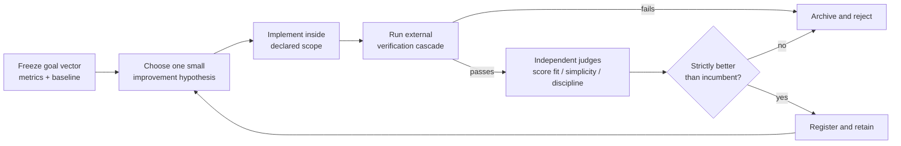

<p align="center"></p>

# ConeCode

**A desktop coding workspace for agents that improve software with evidence—not vibes.**

[简体中文](README.zh-CN.md) · English

ConeCode is a cross-platform desktop AI coding workspace built with **Electron, React, TypeScript, Vite, Tailwind CSS, and Zustand**. It unifies multi-model chat, a file tree, a code editor, an integrated terminal, Git change review and worktrees, live browser preview, desktop computer use, layered long-term memory, an Image Studio, a DSH-compatible plugin market, and phone remote access in a single application.

Conversations rarely start from an empty input box: open a project and ConeCode reads its files, Git diffs, TODOs, scripts, and test signals to propose concrete task cards. For iterative engineering goals, its defining capability is **bounded, evidence-driven Recursive Self-Improvement (RSI)**.

## Table of contents

- [Feature overview](#feature-overview)
- [Agent modes and RSI](#agent-modes-and-rsi)
- [Task flow and Autopilot](#task-flow-and-autopilot)
- [Workspace and conversation experience](#workspace-and-conversation-experience)
- [Built-in agent toolset (42 tools)](#built-in-agent-toolset-42-tools)
- [Models and providers](#models-and-providers)
- [Memory 2.0, Cloud Sync, and Dream Wiki](#memory-20-cloud-sync-and-dream-wiki)
- [Computer Use (CUA), Browser, Image Studio, and Auto-Screenshot](#computer-use-cua-browser-image-studio-and-auto-screenshot)
- [Plugins, DSH Plugin Market, Skills, and MCP](#plugins-dsh-plugin-market-skills-and-mcp)
- [Background runs, Performance Monitor, Notifications, Updates, and Phone Access](#background-runs-performance-monitor-notifications-updates-and-phone-access)
- [Safety model and privacy boundaries](#safety-model-and-privacy-boundaries)
- [Run from source, verification, and packaging](#run-from-source-verification-and-packaging)
- [Project layout](#project-layout)
- [Contributing and license](#contributing-and-license)

## Feature overview

- **Four agent modes**: Standard for one-off tasks, Goal for long measurable deliverables, Orchestrate for conductor-plus-parallel sub-agent work, and RSI for measured self-improvement.
- **Project-first workflow**: Reads files, Git changes, TODOs, scripts, and test signals to propose actionable task cards; **Autopilot** turns a chosen idea into a created, verified, and auto-repaired project.
- **Full desktop workbench**: File tree, multi-root workspaces, built-in code editor with AI edit highlights, integrated terminal, Git change review with batch approvals, Git worktree manager, built-in browser preview and automation, light/dark/system themes, and multi-language UI.
- **Memory 2.0 + Cloud Sync + Dream Wiki**: Five-layer project-isolated long-term memory with versioning, conflict reconciliation, and CJK-aware BM25 search; vendor-neutral REST sync and one-click Google Drive OAuth sync with optional E2E AES-256-GCM encryption; offline **Dream** consolidation into a read-only wiki.
- **Multimodal and desktop control**: Built-in **Image Studio** (zero credential re-entry, 10 art presets, 40-image gallery), **Auto-Screenshot** visual verification, **Desktop Computer Use** with Floating Preview and Manual Control, plus a standalone local-first [`cua/`](cua/README.md) runtime.
- **Extensible ecosystem**: 9 built-in plugins (including GitHub Sync/Release/Reply, Aegis AISearch lookalike-domain screening, Performance Check, Security Review, and more), a **DSH (DeepSeek Harness)-compatible Plugin Market** with an isolated Cordis worker runtime and Official DSH Web launcher, custom **Skills**, and **MCP** servers.
- **Bounded execution and remote control**: Unified **Security Policy** island next to the model selector (3 approval modes + macOS Seatbelt command-write sandbox), episode cost guard, background tasks with sleep prevention, real-time performance anomaly monitor, and QR-paired phone remote access with per-install local TLS and optional Cloudflare tunnel.

## Agent modes and RSI

### Agent modes

| Mode | Behavior | When to use |
|---|---|---|
| **Standard** | Default coding loop—one request, end to end | One-off tasks and quick questions |
| **Goal** | Pursues a declared goal until external completion checks pass | Long-running, verifiable deliverables |
| **Orchestrate** | A conductor decomposes work and spawns parallel sub-agents that research and integrate | Independent workstreams that later merge |
| **RSI** | Bounded, evidence-driven improvement loop over frozen metrics | When iterative, measured improvement itself is the job |

### RSI: improve the software, keep the goal fixed

RSI mode searches for a better version of the open workspace against measurable outcomes—reliability, test health, typecheck cleanliness, latency, completion quality, or a concrete product capability. It is **not** an unbounded self-modifying agent: success criteria, verification commands, and safety boundaries remain anchored outside the agent's opinion.



#### What makes ConeCode's RSI bounded

- **An external oracle, not self-grading**: Before an episode, the agent freezes the goal and 2–5 measurable metrics in the conversation's `GOAL_VECTOR.md`, together with the exact commands, baselines, and non-goals. A candidate cannot pass because the agent says it looks good.
- **Hard verification cascade**: Type checks, targeted tests, full tests, and frozen metric commands run cheapest-first. Any failed required criterion is a hard failure; judges cannot turn a red build green.
- **One module per episode**: Each candidate edits only one declared surface (`loop`, `tools`, `observation`, `context`, `completion`, or `product`), keeping causality reviewable and rollback practical.
- **Reward with a cost for sprawl**: External metrics dominate the score; alignment, simplicity, and discipline judges rank only passing candidates, and oversized diffs are penalized.
- **A real lineage archive**: Accepted and rejected-but-viable candidates retain lineage, metrics, verification evidence, and rationale, enabling exploration of strong underexplored branches instead of blind hill-climbing.
- **Slow registration**: Discovery can move fast; persistent learnings, skills, and workflow updates are registered only after crossing the evidence gate.
- **Explicit stop conditions**: Stops on a plateau, repeated hard failures, an unsafe proposed change, or a scope boundary—never spending unused budget just to churn files.
- **Non-negotiable limits**: RSI cannot weaken approval modes, sandboxing, authentication, TLS, permissions, or tests to raise a score. It cannot edit outside the open workspace, silently redefine metrics, force-push, deploy, publish, or expand its own privileges. Protocol edits are user-gated.

#### How to use RSI mode

1. Open the project and select **RSI** from the agent mode menu, or type `/mode rsi`.
2. State a measurable outcome (e.g., “reduce typecheck errors to zero without weakening tests”).
3. Confirm the charter, metrics, commands, and non-goals before the first candidate runs.
4. Review records in `.conecode/rsi/conversations/<conversation-id>/` (goal vector, candidates, lineage, reflections, discovery trees, and `EVOLUTION_LOG.md`).
5. Keep or revert accepted changes through the normal diff review and Git workflow.

Select a GPT model and confirm the prompt to enable GPT engineering constraints in RSI. **Continue** uses the model currently selected for the conversation.

When starting or resuming an RSI run, ConeCode reloads `DESIGN.md` from the conversation's project root, with `design.md` as a fallback. You can also share design documents or screenshots in the conversation. RSI asks for confirmation if new requirements change the frozen goal, metrics, or scope. [RSI protocol](docs/compose/spec/rsi-direction-selection.md#ui-设计要求)

## Task flow and Autopilot

- **Project-aware suggestions (“Find tasks”)**: Reads local project facts—files, Git changes, TODOs, scripts, and test signals—and proposes concrete task cards you can pick and refine before execution.
- **Autopilot (from idea to verified project)**: Browse model-suggested or built-in project ideas and launch an unattended build-and-verify pipeline:
  1. Creates a deduplicated folder under `<home>/ConeCode Projects/<slug>` seeded with a starter `README.md`.
  2. Opens a dedicated conversation and temporarily switches approval mode to full-auto to build the project.
  3. Resolves or infers a real verification command and runs it inside the configured sandbox.
  4. Feeds real failure output back to the agent for automatic repair (up to 3 attempts), then restores the previous approval mode unconditionally.
- **Human-directed execution**: Opening a folder authorizes nothing. Finding work, starting Autopilot, running commands, and changing approval levels are all explicit user actions.

## Workspace and conversation experience

### Integrated workbench

- **File tree and multi-root workspaces**: Browse files in the sidebar, attach additional directories with `/add-dir`, and run fast file/content searches.
- **Code editor**: Inspect and edit files inline with AI change highlights.
- **Change review**: Review uncommitted or turn-level file diffs and approve or reject changes individually or in batches.
- **Git worktrees**: Create, switch, and clean up isolated Git worktrees via `/worktree` for parallel branch tasks.
- **Integrated terminal**: Run interactive shell sessions synced to the workspace directory.
- **Project brief**: Run `/init` to analyze the repository and generate an `AGENTS.md` project guide.
- **Themes and localization**: Light, dark, and system themes; Simplified Chinese, Traditional Chinese, English, and Japanese UI; resizable workspace panels.

### Conversation controls and slash commands

Type `/` in the chat input to open the autocomplete palette with all 17 built-in commands:

| Command | Action |
|---|---|
| `/help` | List all built-in and project custom commands in chat |
| `/clear` | Start a fresh conversation |
| `/compact` | Compress conversation context to reclaim token budget |
| `/plan` | Toggle plan mode (plan before editing) |
| `/goal <goal>` | Declare a tracked long-running goal and start executing |
| `/mode <mode>` | Switch agent mode (`standard` / `goal` / `orchestrate` / `rsi`) |
| `/review` | Toggle the change review panel |
| `/worktree` | Toggle the Git worktree panel |
| `/init` | Analyze the workspace and generate `AGENTS.md` |
| `/agents` | Open the workspace `AGENTS.md` or view sub-agent status |
| `/add-dir [path]` | Attach an additional root directory to the workspace |
| `/model` | Open the model selector |
| `/memory [query]` | List or open workspace memory files and learned memories |
| `/diff` | Run `git status` and `git diff` and summarize uncommitted changes by file |
| `/commit [notes]` | Review changes, stage all, and craft a Conventional Commit message |
| `/image [prompt]`, `/imagine [prompt]` | Open Image Studio with the prompt pre-filled |

- **Custom project commands**: Add Markdown files under `<workspace>/.conecode/commands/*.md`—the filename becomes the command, the body is the prompt template, and `$ARGUMENTS` is replaced with what you type after the command.
- **In-place message editing**: Edit any past user message and regenerate from that point; cancelling preserves the original transcript.
- **Checkpoints and rollback**: Rewind a conversation to a checkpoint and restore revertable file edits; already-executed shell commands and computer actions are reported honestly rather than silently undone.
- **Session handoff**: Export the full transcript (optionally including tool calls and results) with a takeover prompt as a `.md` file so another AI tool can continue seamlessly.
- **Message queue and stream retry**: Queue follow-up messages mid-run and recover from transient stream interruptions.

## Built-in agent toolset (42 tools)

ConeCode equips the agent with 42 native tools (gated by active mode, plugin toggles, and security policy):

| Category | Tools |
|---|---|
| **Filesystem & search** | `read_file`, `list_dir`, `search`, `glob`, `edit_file`, `create_file`, `create_dir`, `delete`, `rename`, `copy` |
| **Execution, system & background** | `exec`, `open_app`, `open_path`, `system_info`, `run_background`, `background_status` |
| **Git & GitHub** | `git_status`, `git_diff`, `github_push`, `github_release` |
| **Built-in browser automation** | `page_navigate`, `page_snapshot`, `page_click`, `page_fill`, `page_eval`, `page_console` |
| **Computer use & multimodal** | `computer`, `generate_image`, `auto_screenshot` |
| **Memory, planning & collaboration** | `remember`, `memory_search`, `ask_user`, `update_todos`, `use_skill`, `spawn_agent` |
| **Web & download** | `web_fetch`, `web_search`, `download` |
| **Performance & cost telemetry** | `perf_snapshot`, `perf_monitor`, `perf_inspect`, `cost_snapshot` |

Tools and commands from connected MCP servers and installed DSH plugins are automatically bridged into the same toolset (e.g., `mcp__dsh_<plugin>__<tool>` and `mcp__dshcmd_<plugin>__<command>`).

## Models and providers

- **Multi-provider support**: Built-in adapters for **OpenAI, Anthropic, Gemini, DeepSeek, OpenRouter**, and custom **OpenAI-compatible endpoints** using your own credentials.
- **ConeCode Free**: Built-in key-free official relay endpoint with weekly usage quotas for instant onboarding.
- **Model selector**: Grouped by Official-free, Favorites, and Recent; displays capability badges (vision, image generation, audio, function calling) and per-1M-token pricing; supports per-model context-window and max-output overrides with a live read-from-API refresh.
- **Reasoning effort**: Displays a thinking-effort slider for models with extended reasoning, plus a per-model on/off override.
- **Context meter and cost guard**: Tracks live context-window utilization (compressible via `/compact`) and enforces a configurable episode budget lock (default `$0.50` per autonomous episode).

## Memory 2.0, Cloud Sync, and Dream Wiki

Memory 2.0 replaces flat memory files with a **layered, versioned, project-isolated** long-term memory engine. See [`docs/memory-2.0.md`](docs/memory-2.0.md), [`docs/memory-2.0-cloud.md`](docs/memory-2.0-cloud.md), and [`docs/memory-dream.md`](docs/memory-dream.md).

### Five-layer architecture

| Layer | Scope | Typical content |
|---|---|---|
| **Global** | Every project | User preferences, working habits, cross-project constraints |
| **Project** | One `projectId` | Architecture, stack, decisions, known bugs, progress |
| **Episodic** | One `projectId` | Specific task, incident, fix, or failed attempt |
| **Semantic** | One `projectId` | Reusable lessons distilled from episodes |
| **Working** | One `projectId` (TTL) | Current task progress and temporary constraints |

- **Event-driven extraction and noise hygiene**: Triggers only on real value signals (decisions, architecture changes, solved bugs, reusable rules, failures, or session end) and filters out greetings, trivial navigation, and secrets.
- **Status hierarchy and conflict reconciliation**: Distinguishes `confirmed`, `inferred`, `pending`, `superseded`, and `archived`. Automatic extraction never overwrites user-confirmed facts; conflicting claims are kept as `pending` with `conflicts_with` links for human resolution.
- **Real version history and safe migration**: Snapshots previous versions on every update for genuine undo/restore; high-importance records require explicit `force` to overwrite or archive. Idempotently migrates legacy `memory.json` and `CLAUDE.md`/`AGENTS.md` files without mutating originals.
- **CJK-aware hybrid retrieval**: Built-in CJK bigram BM25 full-text search, multi-facet metadata filters, bounded relation expansion, local+cloud merge, and a pluggable semantic embedding provider seam.

### Cloud sync and one-click Google Drive

- **Vendor-neutral REST sync**: Includes a zero-dependency reference server ([`server/memory-cloud/server.mjs`](server/memory-cloud/server.mjs)) and production PostgreSQL schema (`server/memory-cloud/postgres-schema.sql`) with tenant isolation, append-only change logs, idempotent `changeId`s, 3-way merge / conflict preservation, device revocation, backup/restore, and tenant deletion.
- **One-click Google Drive sync**: Connects via OAuth 2.0 loopback + PKCE in the Electron main process, storing snapshots in Drive's hidden `appDataFolder` with ETag-conditional writes.
- **Encrypted credentials and optional E2E**: Cloud tokens are encrypted at rest with Electron `safeStorage` when available. Optional **E2E mode** encrypts titles, content, and tags client-side with **AES-256-GCM (PBKDF2-SHA-256, 120k iterations)** so the server stores ciphertext only (falling back to local decrypted-cache search).

### Dream (offline memory consolidation)

Dream is an optional **read-only hindsight layer** built on top of Memory 2.0:

- Reviews finished idle sessions (≥10 minutes idle, up to 6 per pass) via an `analyzer` and deterministic `organizer`, producing a read-only Markdown wiki (`objects/dream/<scope>/wiki/*.md`, `_index.md`, `index.json`, `history/`).
- **Dual secret redaction and zero deletion**: Redacts secrets from both transcripts and generated wiki text; archives prior versions before overwrites (keeping 8 versions / 180 days per topic); preserves all facts during merges with `MOVED TO [[target]]` stubs and automatic link rewriting.
- **Trigger and browsing**: Run manually or enable daily auto-consolidation from **Memory → Overview → Dream**; browse topics read-only in the **Dream wiki** tab; future sessions mount the index plus up to 2 relevant topics.

## Computer Use (CUA), Browser, Image Studio, and Auto-Screenshot

### Desktop Computer Use and Floating Preview

- **Window-targeted control**: Enable **Computer Use** and select an open application window (the agent can also list apps and switch windows under your approval policy). Switching clears the preview so screenshots and coordinates strictly match the active target.
- **Floating Preview and Manual Control**: Open **Floating preview** to watch the live orange pointer and click ring. Enable **Manual control** in the preview toolbar to click the captured image or send text directly (right-click and scroll are also supported on Windows), with automatic refresh after each action.
- **Platform scope**: macOS uses Accessibility controls for clicking and typing; Windows captures background windows via window messages and brings the target forward on input; Linux desktop Computer Use is unavailable, while ConeCode's separate manual region-screenshot tool remains available.

### Standalone CUA runtime (`cua/`)

The repository also ships an independent, local-first Computer Use Agent runtime in [`cua/`](cua/README.md) (see [`docs/computer-use-agent.md`](docs/computer-use-agent.md)) that does not modify the Electron app:

- Task/observation/action/verification/event protocols with a SQLite WAL log;
- Real Chromium Playwright browser driver (structured targets + screenshots);
- Native macOS `CGEvent` keyboard/mouse driver with TextEdit app-scripting verification;
- Independent task verifier, isolated persistent code runtime, React console, CLI, typed SDK, and stdio MCP server.

### Built-in browser preview and automation

- Preview local dev servers or web pages inside the workbench; the agent can navigate, inspect DOM snapshots, click, fill inputs, evaluate scripts, and read console output via `page_*` tools under built-in browser security policies.

### AI Image Studio

- **Two entry points**: Ask in chat (native `generate_image` tool) or type `/image` / `/imagine` to open Image Studio.
- **Zero credential re-entry**: Reuses configured providers (auto-match, ConeCode Free, a chosen provider, or a custom OpenAI-compatible image endpoint).
- **Studio controls**: Five aspect ratios (`1:1`, `16:9`, `9:16`, `4:3`, `3:4`), DALL·E 3 quality/style options, negative prompts for other models, and 10 local art presets (photorealistic, anime, cyberpunk, 3D character, ink wash, oil painting, fantasy, minimalist, pixel art, hard sci-fi).
- **Local gallery**: Stores the latest 40 images locally with copy, save, fullscreen, and one-click remix back into the studio.

### Auto-Screenshot

- After UI or page edits, the agent can invoke `auto_screenshot` to capture the **app window, preview pane, or full screen**, verify non-empty decoded PNG frames, and attach them for multimodal visual verification.
- Configurable default target (`auto` / `window` / `preview` / `screen`), capture delay, optional disk saving, and history cap (default 24, max 60).

## Plugins, DSH Plugin Market, Skills, and MCP

### 9 built-in plugins

Manage built-in plugins in **Settings → Plugins**, or let the agent guide you through creating custom plugins:

| Plugin | What it does |
|---|---|
| **GitHub Sync** | Saves repository presets, authenticates via the free [GitHub CLI](https://cli.github.com/) or a PAT, creates branches, and pushes selected local branches; shares credentials with **GitHub Release publishing** and the **Issue/PR Reply Assistant** (drafts locally, posts only after confirmation; continuous webhook replies are available via the optional self-hosted [`github-reply-bot/`](github-reply-bot/README.md)) |
| **Performance Check** | Audits the app for performance defects—report-only, never edits files |
| **Security Review** | Rule-based vulnerability review for the whole repo or changed files only |
| **TODO Scan** | Sweeps the repository for `TODO`/`FIXME` entries sorted by staleness |
| **Commit Message** | Reads the diff and drafts a Conventional Commit message without committing |
| **Repo Tour** | Newcomer map: boot chain, module list, and the first three files to read |
| **AI Image Generation** | Toggles the `generate_image` tool and links to the gallery and Image Studio |
| **Auto-Screenshot** | Toggles the `auto_screenshot` tool and capture settings for visual UI checks |
| **Aegis AISearch** | Screens search-result URLs locally to flag lookalike/phishing domains, with optional VirusTotal API v3 domain reputation checks |

### DSH-compatible Plugin Market

Open **Plugin Market** via the puzzle-piece icon in the sidebar (see [`docs/dsh-market/README.md`](docs/dsh-market/README.md)) to unify **ConeCode-native plugins** with **DeepSeek Harness (DSH `0.2.2-rc.1`) community plugins**:

- **Four workflows**:
  - **Discover**: Search, filter by category/compatibility, and sort by relevance, publish time, npm downloads, or GitHub stars (real point-in-time API observations with provenance);
  - **Installed**: Enable/disable, per-row JSON config validation, logs, direct tool/command runner, update with automatic rollback, and uninstall with optional data retention;
  - **Sources & runtime**: Manage bundled/remote/local catalogs, import local folders or `.tgz` archives, and inspect pinned runtime facts;
  - **Repository import**: Import `github:owner/repo` or public HTTPS Git URLs (with optional ref and subdirectory), resolved to an exact pinned commit with preview before install.
- **Isolated Cordis runtime**: Runs `@deepseek-ai/cordis` 4.1.0 inside a dedicated Electron `worker_threads` worker hosting tools, commands, skills, and the official DSH storage stack (`@deepseek-ai/dsh-storage` / `json` / `domain`). The renderer never executes third-party plugin code; lifecycle scripts are off by default (`--ignore-scripts`), and upgrades run probe activation before swapping.
- **Official DSH Web**: For themes and browser/client UI plugins, choose **Install in DSH Web** to install via the local official `dsh` CLI and run in an isolated Web profile.
- **Developer docs**: [Plugin authoring](docs/dsh-market/plugin-authoring.md) · [Compatibility matrix](docs/dsh-market/compatibility.md) · [Catalog format](docs/dsh-market/catalog-format.md) · Native example [`examples/native-plugins/hello-conecode/`](examples/native-plugins/hello-conecode/).

### Skills and MCP

- **Skills**: Reusable `SKILL.md` agent workflows with dedicated run views and an in-app skill editor; all actions executed by skills remain bound by your approval mode and sandbox.
- **MCP (Model Context Protocol)**: Built-in MCP client to connect external tool servers alongside native tools.

## Background runs, Performance Monitor, Notifications, Updates, and Phone Access

- **Background tasks & sleep prevention**: Manage long-running background jobs via `run_background` / `background_status` and optionally prevent system sleep while tasks run.
- **Notifications**: Choose never, background-only, or always, plus an independent toggle for approval-request notifications.
- **Real-time performance & error monitor**: When enabled, polls renderer JS heap, main process RSS, free system memory, and per-CPU load every 5 seconds, captures uncaught renderer errors, and sends desktop alerts on sustained threshold breaches (check-only, never auto-edits).
- **Auto-updates**: Built-in update checker and installer; Linux AppImage builds automatically generate `.AppImage.zsync` for delta updates.
- **Phone remote access**: QR-pairing popover in the sidebar:
  - Generates a unique local TLS certificate per installation;
  - Requires a password whenever a public Cloudflare tunnel is enabled;
  - Shares the same slash commands and approval scope as the desktop app.

## Safety model and privacy boundaries

### Security Policy island

Approval mode and the command sandbox live together in a single **Security Policy** island next to the model selector:

| Approval mode | Behavior |
|---|---|
| **Confirm each step** (default) | Every file edit and command requires confirmation—the safest level |
| **Auto-edit files** | File edits apply automatically; commands still ask |
| **Fully automatic** | Edits and commands run without asking; highlighted in red as an explicit risk state |

- **macOS Seatbelt sandbox**: Commands may read the machine but can write only inside the workspace and an isolated per-run scratch directory, with an independent network toggle (needed for installing dependencies). Disabled—or on Windows/Linux—commands run with normal user permissions.
- **Unattended override**: RSI and Autopilot temporarily elevate approval mode to full-auto and restore the saved policy afterwards, showing an amber notice on the island while active.
- **In-chat approvals**: Command dialogs and batch file-change reviews appear inline and are scoped strictly to the active conversation.

### Privacy and execution boundaries

- **Local storage & credentials**: Conversations and settings are stored in Electron's local application-data directory. Model provider API keys are currently stored in local JSON rather than an OS keychain—protect this directory and never upload it. Cloud memory tokens and Google Drive refresh tokens use Electron `safeStorage` encryption when available.
- **External requests**: Model calls may include selected project context; optional Memory 2.0 extraction and Dream consolidation issue requests to your configured provider. Provider retention and billing policies apply.
- **High-authority features**: Full-auto mode, custom skills, MCP servers, Computer Use, and remote access carry significant local authority—enable them only for trusted tasks and tools.
- **Message edit vs. file rollback**: Editing a past message truncates subsequent chat turns but does not undo already-applied file edits or external commands; use checkpoint rollback for revertable file changes.
- **Remote TLS**: Each installation generates its own self-signed TLS key; browsers do not auto-trust self-signed certificates, and reinstalling requires re-pairing. Keep remote access off when unused and treat pairing links as credentials.

## Run from source, verification, and packaging

### Prerequisites

- **Node.js 24** (recommended; minimum `>=22.12.0`)
- npm and Git

### Development and local run

```bash
npm ci
npm run dev       # Starts Vite and Electron together (including dsh-worker build)
```

Local production build:

```bash
npm run build
npm start
```

> The repository ships no API keys, signing certificates, application data, or prebuilt installers. Configure your own provider inside the app or use ConeCode Free.

### Verification

```bash
npm run typecheck # TypeScript type check
npm test          # Vitest test suite
npm run build     # Production build
npm audit         # Dependency audit
```

Some tests start local loopback servers. macOS sandbox integration tests execute real processes under `sandbox-exec` when available and are conditionally skipped elsewhere.

### Packaging and optional tunnel binary

```bash
npm run dist              # macOS DMG
npm run dist:mac:unsigned # Unsigned macOS build
npm run dist:win          # Windows x64 NSIS installer
npm run dist:linux        # Linux x64 AppImage (with .AppImage.zsync)
npm run dist:all          # macOS arm64 + Windows x64 + Linux x64 in one run
npm run catalog:sync      # Sync DSH plugin market catalog index
```

- **AppImage updates**: Install `zsyncmake` on the build host (`zsync` package on Ubuntu) so builds emit `.AppImage.zsync` alongside the `.AppImage` for AppImageUpdate.
- **Optional `cloudflared` binaries**: Not committed to the repository. For bundled tunnel support, place binaries from [official Cloudflare releases](https://github.com/cloudflare/cloudflared/releases) at:
  - macOS Apple Silicon: `resources/bin/cloudflared-darwin-arm64`
  - Windows x64: `resources/bin/cloudflared-win-x64.exe`
  - Linux x64: `resources/bin/cloudflared-linux-x64`

  Or remove the matching `extraResources` entry in `package.json`; ConeCode also supports a separately installed `cloudflared` binary.

## Project layout

```text
electron/                  Electron main process, IPC, Aegis search check, GitHub suite, Memory 2.0/Drive,
                           DSH market runtime, Computer Use & Floating Preview, preview server, remote, RSI, terminal, updates
src/
  components/              UI panels: chat / model / layout / editor / review / worktree / terminal /
                           preview / computer / screenshot / rsi / memory / plugins / dsh-market /
                           skills / subagents / background / handoff / remote / provider / home / update
  stores/                  Zustand stores & tests: agent loop, modes, goals, Autopilot, models, cost,
                           Memory 2.0/Dream, Computer Use, Auto-Screenshot, Image Studio, monitor, updates, i18n, theme
  core/
    agents/                RSI reward, verification cascade, lineage, replay, persistence, and mode prompts
    agenda/                Project analysis, task suggestions, and Autopilot idea/build flow
    providers/             Provider adapters (OpenAI, Anthropic, Gemini, DeepSeek, OpenRouter, free relay, custom)
    tools/                 42 built-in agent tool definitions and toolset assembly
    memory/                Memory 2.0 layered engine, retrieval, cloud/Drive sync, migration, and Dream
    exec/                  macOS Seatbelt sandbox and command execution
    browser/               Built-in browser policies and automation bridge
    computer/              Computer Use and Floating Preview client protocol
    image/                 Image Studio request builder and 10 art presets
    dsh-market/            DSH-compatible plugin market types, catalog sources, and adapter
    plugins/ skills/ mcp/  Built-in plugin registry, skills system, and MCP client
    remote/ handoff/       Phone bridge, QR pairing, and transcript handoff exporter
    commands.ts            Slash-command registry and template expansion
server/
  memory-cloud/            Zero-dependency Memory 2.0 reference cloud server and PostgreSQL schema
  plugins/aegis-search/    Aegis AISearch local lookalike-domain detector
cua/                       Standalone local-first Computer Use Agent runtime (Playwright + native macOS)
github-reply-bot/          Optional self-hosted GitHub Issue/PR webhook reply service
examples/                  Minimal runnable DSH and ConeCode-native plugin examples
scripts/                   Catalog sync, AppImage zsync, computer preview smoke test, release verification
resources/                 Bundled DSH catalog/verifications and optional cloudflared binaries
preview/                   Standalone UI development examples
docs/                      Detailed docs for RSI, Memory 2.0, Cloud, Dream, CUA, and DSH Plugin Market
```

## Contributing and license

Keep pull requests focused, run `npm run typecheck` and `npm test`, and never include API keys, pairing links, private logs, or personal project data in issues or PRs. For security vulnerabilities, use private vulnerability reporting where available.

**License:** [MIT](LICENSE) — free to use, modify, and redistribute with the copyright notice kept.
