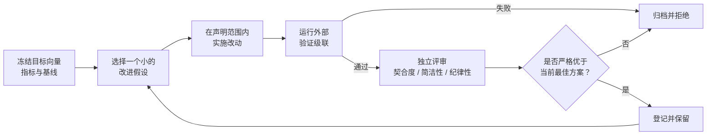

<p align="center"></p>

# ConeCode

**以证据驱动软件演进的桌面 AI 编程工作台——让 AI 先读懂项目、提出建议，并在可控边界内自主完成交付与持续改进。**

简体中文 · [English](README.md)

ConeCode 是一款基于 **Electron、React、TypeScript、Vite、Tailwind CSS 与 Zustand** 构建的跨平台桌面 AI 编程工作台。它将多模型对话、文件树、代码编辑器、集成终端、Git 变更审查与 Worktree、内置浏览器预览、电脑操控、分层长期记忆、图像工坊、DSH 兼容插件市场以及手机远程访问整合在同一个应用内。

ConeCode 不必从空白输入框开始：打开项目后，它会读取文件结构、Git 改动、TODO、脚本和测试信号，主动提出可执行的任务卡片；对于需要长期迭代的工程任务，它提供**受约束、外部指标驱动的递归自我改进（RSI）回路**。

## 目录

- [功能全景](#功能全景)
- [四种 Agent 模式与 RSI 自我改进](#四种-agent-模式与-rsi-自我改进)
- [任务流与无人值守 Autopilot](#任务流与无人值守-autopilot)
- [桌面工作台与对话体验](#桌面工作台与对话体验)
- [内置 Agent 工具集（42 项）](#内置-agent-工具集42-项)
- [模型与服务商管理](#模型与服务商管理)
- [Memory 2.0 分层记忆、云同步与 Dream Wiki](#memory-20-分层记忆云同步与-dream-wiki)
- [电脑操控（CUA）、内置浏览器、图像工坊与自动截图](#电脑操控cua内置浏览器图像工坊与自动截图)
- [插件库、DSH 插件市场、技能与 MCP](#插件库dsh-插件市场技能与-mcp)
- [后台任务、性能监控、通知、更新与手机远程访问](#后台任务性能监控通知更新与手机远程访问)
- [安全模型与隐私边界](#安全模型与隐私边界)
- [从源码运行、检查与打包](#从源码运行检查与打包)
- [代码结构](#代码结构)
- [参与改进与许可证](#参与改进与许可证)

## 功能全景

- **四种 Agent 模式**：Standard（标准一次性交付）、Goal（目标驱动直到外部验收通过）、Orchestrate（指挥器拆解并派发并行子代理）、RSI（受约束、可度量的递归自我改进）。
- **先读项目再开口**：自动扫描项目文件、Git 状态、TODO、脚本与测试线索，生成具体任务卡片；同时支持 **Autopilot** 从创意自动建仓、开发、运行真实命令验证并自动修复。
- **完整集成工作台**：文件树、多根目录工作区、内置代码编辑器（支持 AI 改动高亮）、集成终端、Git 变更审查与批量审批、Git Worktree 管理、内置浏览器实时预览与自动化控制、暗色/亮色/跟随系统主题及多语言界面。
- **Memory 2.0 + 云同步 + Dream Wiki**：五层项目隔离长期记忆、版本历史与冲突裁决、CJK 友好 BM25 全文检索；支持自托管 REST 云服务与一键 Google Drive OAuth 同步（可选端到端 AES-256-GCM 加密）；内置 **Dream** 离线整理器，将会话沉淀为只读知识 Wiki。
- **多模态与端到端操控**：内置 **AI 图像工坊**（零重填凭据、10 种艺术预设、40 张本地画廊）、**自动截图**视觉验证、**桌面电脑操控**（带悬浮实时指针与手动接管），并附带独立的 [`cua/`](cua/README.md) 本地 Computer Use 运行时。
- **丰富扩展生态**：9 款内置插件（含 GitHub 全流程同步/发布/Issue 回复、Aegis AISearch 仿冒域名审查、性能巡检、安全审查等）、**DSH（DeepSeek Harness）兼容插件市场**（Cordis 隔离 Worker 运行时 + 官方 DSH Web 启动）、自定义 **Skills** 以及 **MCP** 外部工具协议。
- **受控执行与远程协同**：模型栏旁统一的「安全策略」圆岛（三级审批 + macOS Seatbelt 写入沙箱）、费用预算锁、后台任务与防休眠、性能异常实时监控、扫码配对手机远程访问（独立本地 TLS 证书 + 可选 Cloudflare 隧道）。

## 四种 Agent 模式与 RSI 自我改进

### Agent 模式对比

| 模式 | 行为方式 | 适用场景 |
|---|---|---|
| **Standard（标准）** | 默认编码循环，单次请求端到端完成 | 日常开发、一次性需求与快速问答 |
| **Goal（目标）** | 围绕明确声明的目标持续推进，直到外部验收命令通过 | 跨多轮、可验证的完整功能交付 |
| **Orchestrate（编排）** | 指挥器拆解任务并派发多个并行子代理，独立调研/实现后再统一汇总 | 可并行拆分的大型分析或跨模块改造 |
| **RSI（递归自我改进）** | 在冻结指标与硬验证门槛约束下，小步迭代搜索更优软件版本 | 测试稳定性提升、清零类型错误、性能优化等持续度量型改进 |

### RSI：以可验证的方式持续改进软件

RSI 模式并非“让 AI 无限修改自己”，而是面向**可量化工程目标**的受控改进回路。Agent 只能在当前工作区提出并实施小步候选改动，而成功标准、验证命令和安全边界全部固定在 Agent 主观判断之外。



#### 为什么 ConeCode 的 RSI 是可控的

- **外部裁判，不靠自我打分**：首轮开始前，会在该会话的 `GOAL_VECTOR.md` 冻结目标、2–5 个可衡量指标、精确验证命令、基线与非目标。“看起来更好”不能算作通过。
- **硬验证级联**：类型检查、局部测试、全量测试与冻结指标按成本从低到高依次执行。任何必要条件失败即判定为硬失败，评审不能将红灯变绿灯。
- **每轮只改一个模块**：每次候选改动只能作用于声明的单一边界面：`loop`、`tools`、`observation`、`context`、`completion` 或 `product`，保证因果可归因、改动可审查、失败可回滚。
- **带复杂度惩罚的评分机制**：外部指标提升占主导；契合度、简洁性与纪律性独立评审仅在已通过硬验证的候选中排序，且超大 diff 会被扣分。
- **完整谱系档案，而非只记胜者**：已接受以及通过验证但暂未胜出的候选都会保留父节点谱系、指标、验证证据与理由，允许在发现树中回溯探索潜力分支，避免盲目单路爬坡。
- **发现快、登记慢**：探索可以高频迭代，但持久化经验、技能或工作流变更必须跨过证据门槛后才能登记，防止偶发成功污染长期状态。
- **显式停止条件**：遇到平台期、连续硬失败、不安全提议或范围越界时主动停止，绝不为了消耗预算而制造无效改动。
- **不可逾越的安全红线**：RSI 严禁为了提高分数而削弱审批模式、沙箱、认证、TLS、权限或测试；不得修改工作区以外文件、暗中篡改指标、强制推送、部署、发布或扩权；对 RSI 协议本身的修改必须经过用户明确批准。

#### 如何使用 RSI 模式

1. 打开目标项目，在 Agent 模式菜单选择 **RSI**，或在输入框键入 `/mode rsi`。
2. 描述可度量的改进目标（例如：“在不削弱任何测试的前提下将类型检查错误清零”）。
3. 首轮候选运行前，确认章程、指标、精确验证命令与非目标。
4. 在 `.conecode/rsi/conversations/<会话 ID>/` 中查看目标向量、候选记录、谱系树、反思、发现树以及 `EVOLUTION_LOG.md`。
5. 通过正常的 Diff 审查与 Git 流程决定保留或回退改动。

选中 GPT 并确认启用后，RSI 会应用 GPT 工程约束。点击「继续」时，会话会使用当前选定的模型。

启动或恢复 RSI 时，ConeCode 会重新读取该会话项目根目录的 `DESIGN.md`，不可用时查找 `design.md`。也可以在会话中提供设计文档或截图。新要求涉及已冻结的目标、指标或范围时，RSI 会先请求确认。[RSI 运行规范](docs/compose/spec/rsi-direction-selection.md#ui-设计要求)

## 任务流与无人值守 Autopilot

- **项目感知任务建议（寻找任务）**：读取当前工作区的文件结构、Git 变更、TODO 注释、可用脚本与测试线索，由所选模型生成具体的任务卡片；你挑选任务、补充约束后再交由 AI 执行。
- **Autopilot（从创意到可运行项目）**：浏览模型推荐或内置的项目创意，选定方向后进入无人值守流水线：
  1. 在 `<主目录>/ConeCode Projects/<项目名>` 自动创建不重名目录并写入初始 `README.md`；
  2. 创建专属会话并临时切换至全自动审批模式进行端到端构建；
  3. 自动解析或推断真实校验命令，在沙箱内运行验证；
  4. 若验证失败，将真实输出回传模型自动修复（最多 3 轮），结束后无论成败均恢复原有审批策略。
- **执行权始终归人**：仅打开文件夹不会授权任何写操作或命令执行；寻找任务、启动 Autopilot、切换审批级别均为显式人工动作。

## 桌面工作台与对话体验

### 集成工作台面板

- **文件树与多目录工作区**：侧边栏浏览项目文件，支持通过 `/add-dir` 附加额外工作目录，并内置快速文件与内容搜索。
- **代码编辑器**：在应用内直接查看与编辑文件，并高亮展示 AI 最近修改的代码区域。
- **变更审查（Review）**：集中展示未提交或本轮 AI 产生的文件差异，支持逐项或批量接受/拒绝。
- **Git Worktree 管理**：内置 `/worktree` 面板，为并行分支任务创建、切换和清理独立 Git 工作树。
- **集成终端**：内置交互式终端会话，与当前项目目录同步。
- **项目简报（Project Brief）**：通过 `/init` 自动分析项目结构、命令与代码约定并生成 `AGENTS.md`。
- **界面与个性化**：支持亮色 / 暗色 / 跟随系统主题，以及简体中文、繁体中文、英文、日文多语言界面，可自由拖拽调整各面板尺寸。

### 对话能力与斜杠命令

在输入框键入 `/` 即可唤出命令自动补全面板，支持全部 17 条内置命令：

| 命令 | 说明 |
|---|---|
| `/help` | 在对话中列出所有内置命令与当前项目自定义命令 |
| `/clear` | 开启全新空白会话 |
| `/compact` | 压缩当前会话上下文以释放 token 空间 |
| `/plan` | 切换计划模式（先规划再动手） |
| `/goal <目标>` | 为当前会话设定可追踪的长期目标并开始执行 |
| `/mode <模式>` | 切换 Agent 模式（`standard` / `goal` / `orchestrate` / `rsi`） |
| `/review` | 打开/关闭代码变更审查面板 |
| `/worktree` | 打开/关闭 Git Worktree 管理面板 |
| `/init` | 分析当前工作区并生成 `AGENTS.md` 项目简报 |
| `/agents` | 打开当前工作区的 `AGENTS.md` 或查看子代理状态 |
| `/add-dir [路径]` | 为当前工作区附加额外的根目录 |
| `/model` | 打开模型选择器 |
| `/memory [关键词]` | 列出或打开工作区记忆文件与已学习记忆 |
| `/diff` | 运行 `git status` 与 `git diff` 并按文件总结未提交改动 |
| `/commit [补充说明]` | 审查改动、暂存并起草符合 Conventional Commits 规范的提交信息 |
| `/image [提示词]`、`/imagine [提示词]` | 打开图像工坊并自动预填提示词 |

- **项目自定义命令**：在 `<工作区>/.conecode/commands/*.md` 中新建 Markdown 文件，文件名即命令名，正文即提示词模板，`$ARGUMENTS` 会自动替换为用户在命令后输入的文本。
- **原位编辑与重新生成**：可直接修改任意历史用户消息并从该节点重新生成；取消编辑则完整保留原对话。
- **检查点与文件回滚**：支持将对话回滚到指定检查点并恢复可撤销的文件修改；对已执行的终端命令或外部操作会如实报告而非假装撤销。
- **会话交接（Handoff）**：将完整对话记录（可选包含工具调用与返回结果）连同接手提示词导出为 `.md` 文件，可直接交给其他 AI 工具无缝续接。
- **消息队列与流式重试**：支持对话中排队发送后续消息及网络中断后的流式重试。

## 内置 Agent 工具集（42 项）

ConeCode 为 Agent 配备了 42 项原生工具（受当前模式、插件开关及安全策略约束）：

| 类别 | 工具名称 |
|---|---|
| **文件读写与搜索** | `read_file`、`list_dir`、`search`、`glob`、`edit_file`、`create_file`、`create_dir`、`delete`、`rename`、`copy` |
| **命令、系统与后台** | `exec`、`open_app`、`open_path`、`system_info`、`run_background`、`background_status` |
| **Git 与 GitHub** | `git_status`、`git_diff`、`github_push`、`github_release` |
| **内置浏览器自动化** | `page_navigate`、`page_snapshot`、`page_click`、`page_fill`、`page_eval`、`page_console` |
| **电脑操控与多模态** | `computer`、`generate_image`、`auto_screenshot` |
| **记忆、规划与协作** | `remember`、`memory_search`、`ask_user`、`update_todos`、`use_skill`、`spawn_agent` |
| **联网与下载** | `web_fetch`、`web_search`、`download` |
| **性能与费用观测** | `perf_snapshot`、`perf_monitor`、`perf_inspect`、`cost_snapshot` |

此外，通过 MCP 服务和 DSH 插件市场安装的工具与命令会自动桥接进 Agent 工具表（如 `mcp__dsh_<插件>__<工具>` 与 `mcp__dshcmd_<插件>__<命令>`）。

## 模型与服务商管理

- **多服务商原生适配**：内置 **OpenAI、Anthropic、Gemini、DeepSeek、OpenRouter** 以及任意 **自定义 OpenAI 兼容端点**，全部使用你自己的 API 凭据。
- **ConeCode Free**：内置官方免费中转端点，无需配置 API Key 即可开箱体验（按周计量用量配额）。
- **增强型模型选择器**：
  - 按官方免费、收藏、最近使用分组；
  - 直观展示能力图标（视觉、图像生成、音频、函数调用）及每百万 token 输入/输出价格；
  - 支持按单模型覆写上下文窗口大小与最大输出 token，并支持一键从服务商 API 刷新模型列表与元数据。
- **扩展推理控制**：当所选模型支持深度思考/扩展推理时，自动出现思考强度滑杆，并支持按模型单独开关推理模式。
- **上下文计量与费用护栏**：实时展示当前对话占模型上下文窗口的比例（随时用 `/compact` 压缩）；提供**费用锁**为单轮无人值守执行设置预算上限（默认 0.5 美元/轮）。

## Memory 2.0 分层记忆、云同步与 Dream Wiki

Memory 2.0 用**分层、带版本、严格按项目隔离**的长期记忆引擎取代了传统扁平清单。详见 [`docs/memory-2.0.md`](docs/memory-2.0.md)、[`docs/memory-2.0-cloud.md`](docs/memory-2.0-cloud.md) 与 [`docs/memory-dream.md`](docs/memory-dream.md)。

### 五层记忆架构与生命周期

| 层级 | 作用域 | 典型内容 |
|---|---|---|
| **Global（全局）** | 跨全部项目 | 个人偏好、编码习惯、全局约束 |
| **Project（项目）** | 单一 `projectId` | 架构决策、技术栈、已知缺陷、里程碑进展 |
| **Episodic（情景）** | 单一 `projectId` | 某次任务、故障排查、修复记录或失败尝试 |
| **Semantic（语义）** | 单一 `projectId` | 从多次情景中提炼的可复用规律与经验 |
| **Working（工作）** | 单一 `projectId`（带 TTL） | 当前任务进度与临时约束 |

- **事件驱动抽取与噪声治理**：仅在识别到决策、架构变更、问题解决、可复用规则、失败教训或会话结束等真实价值信号时触发抽取，自动过滤寒暄、无意义导航与密钥敏感信息。
- **状态分级与冲突裁决**：区分 `confirmed`（用户明确确认）、`inferred`（Agent 推断）、`pending`、`superseded`、`archived`；自动抽取永远无法覆盖已确认事实，冲突条款将并存为 `pending` 并关联 `conflicts_with` 交由人工裁决。
- **真实版本历史与安全迁移**：每次更新自动保存历史快照，支持撤销与版本回滚；高重要性记录需要显式 `force` 才可覆写或归档。支持从旧版 `memory.json` 及 `CLAUDE.md` / `AGENTS.md` 无损幂等迁移。
- **CJK 友好混合检索**：内置中文双字切片（bigram）BM25 全文检索、多维元数据过滤（项目/层级/类型/状态/标签/置信度/时间范围）、受限关系图扩展与本地+云端混合排序，并预留可插拔向量语义检索引擎接口。

### 云同步与一键 Google Drive

- **厂商中立 REST 同步**：内置零依赖参考云服务 [`server/memory-cloud/server.mjs`](server/memory-cloud/server.mjs) 及生产级 PostgreSQL 建表脚本 `server/memory-cloud/postgres-schema.sql`，支持多租户隔离、追加式变更日志（cursor）、幂等 `changeId`、三方合并与冲突保留、设备吊销、云端备份/恢复及租户销毁。
- **一键 Google Drive 同步**：主进程内通过 OAuth 2.0 Loopback + PKCE 连接 Google Drive 隐藏 `appDataFolder`，以 ETag 条件写防并发覆盖，不污染“我的云端硬盘”。
- **凭据加密与可选端到端加密（E2E）**：云端令牌优先使用 Electron `safeStorage` 加密落盘；开启 E2E 后，标题、正文与标签在上传前使用 **AES-256-GCM（PBKDF2-SHA-256，120k 次迭代）** 本地加密，服务端仅存密文（此时自动回退至本地解密缓存检索）。

### Dream 离线记忆整理

Dream 是运行在 Memory 2.0 之上的**只读离线回看层**：

- 仅处理已结束且空闲 ≥10 分钟的历史会话（每轮最多 6 个），经由 `analyzer` 提取可复用事实，再由 `organizer` 确定性合并、去重并维护 Wiki 索引（`objects/dream/<scope>/wiki/*.md`、`_index.md`、`index.json`、`history/`）。
- **双重脱敏与零删除**：输入 transcript 与产出正文均经过密钥脱敏；覆盖前自动归档旧版本（每主题保留最近 8 份 / 180 天）；合并时保留全部事实并留下 `MOVED TO [[target]]` 存根及自动链接重写。
- **触发与浏览**：可在「Memory 面板 → 总览 → Dream 记忆整理」手动触发或开启每日自动整理；在「Dream wiki」页签只读浏览所有主题；后续会话会自动挂载索引及最相关的最多 2 个主题。

## 电脑操控（CUA）、内置浏览器、图像工坊与自动截图

### 桌面电脑操控与悬浮预览

- **应用窗口级精准操控**：在「电脑操控」面板启用并选中目标窗口，Agent 也可在审批策略下枚举应用并切换窗口；切换窗口时自动清空旧预览，确保截图与坐标严格对应当前目标。
- **悬浮预览与手动接管**：打开「悬浮预览」可实时观察橙色指针位置与点击波纹圆环；开启「手动操控」后可直接点击预览画面或通过工具栏输入文字（Windows 下还支持右键与滚轮），操作后自动刷新画面。支持手动刷新截图与拖拽移动悬浮窗，停止操控后自动清空画面与指针。
- **平台边界**：macOS 通过无障碍控件实现点击与键入；Windows 通过窗口消息捕获后台窗口并在发送输入时前置目标窗口；Linux 暂不支持桌面电脑操控，但仍可使用 ConeCode 独立的区域手动截图工具。

### 独立 CUA 运行时（`cua/`）

仓库同时包含独立的本地优先 Computer Use Agent 运行时 [`cua/`](cua/README.md)（详见 [`docs/computer-use-agent.md`](docs/computer-use-agent.md)），不干扰主 Electron 应用：

- 任务/观测/动作/验收/事件协议与 SQLite WAL 日志；
- 真实 Chromium Playwright 浏览器驱动（结构化目标 + 截图）；
- macOS 原生 `CGEvent` 键鼠驱动与 TextEdit 脚本化保存验收；
- 独立任务验收器、持久化代码沙箱、React 控制台、CLI、TypeScript SDK 与 stdio MCP 服务。

### 内置浏览器预览与自动化

- 在工作台内直接预览本地开发服务或网页，Agent 可通过 `page_navigate`、`page_snapshot`、`page_click`、`page_fill`、`page_eval`、`page_console` 读取 DOM、执行脚本、抓取控制台报错并驱动页面交互，全部受内置浏览器策略管控。

### AI 图像工坊（Image Studio）

- **双入口**：对话中直接让 Agent 调用 `generate_image` 工具，或输入 `/image`、`/imagine` 打开专业图像工坊。
- **凭据零重填**：自动复用已配置的服务商（自动匹配、ConeCode Free、指定服务商或自定义 OpenAI 兼容图像端点）。
- **丰富创作控制**：5 种画幅比例（1:1、16:9、9:16、4:3、3:4）、DALL·E 3 画质与风格参数、其他模型的负向提示词，以及 10 种本地提示词扩充艺术预设（真实摄影、二次元动漫、赛博朋克、3D 萌系、东方水墨、古典油画、奇幻魔法、极简美学、复古像素、硬核科幻）。
- **本地画廊**：自动保存最近 40 张作品，支持复制、另存、全屏查看以及一键带原提示词回工坊二创（Remix）。

### 自动截图（Auto-Screenshot）

- 修改前端界面或页面后，Agent 可调用 `auto_screenshot` 工具自动抓取**应用窗口、预览页或整个屏幕**，解码校验非空帧后直接附带给多模态模型进行视觉验收。
- 在插件设置中可自定义默认目标（`auto` / `window` / `preview` / `screen`）、延迟毫秒数、是否自动保存至磁盘以及历史记录上限（默认 24 张，最高 60 张）。

## 插件库、DSH 插件市场、技能与 MCP

### 9 款内置插件

在「设置 → 插件」可搜索、启停、配置内置插件，或通过对话引导创建自定义插件：

| 插件 | 功能说明 |
|---|---|
| **GitHub 同步** | 保存多套仓库预设，支持通过免费的 [GitHub CLI](https://cli.github.com/) 浏览器登录或填写 PAT；支持新建分支、选择本地分支与远程目标一键推送；与 **GitHub Release 发布** 及 **Issue/PR 回复助手** 共用凭据（回复助手在本地起草、人工确认后发布；如需 7×24 Webhook 自动值守，可部署仓库内的自托管服务 [`github-reply-bot/`](github-reply-bot/README.md)） |
| **性能巡检** | 按规则巡检应用自身性能缺陷，只出诊断报告、不自动改代码 |
| **安全审查** | 按规则审查代码安全漏洞，支持全仓扫描或仅审查本次变更文件 |
| **TODO 扫描** | 全仓扫描 `TODO`/`FIXME` 注释并按陈旧程度排序 |
| **提交信息** | 读取当前 diff 生成符合 Conventional Commits 规范的提交信息，只写不提交 |
| **仓库导览** | 为新人或 Agent 生成项目导览：启动链、核心模块表及最值得先读的 3 个文件 |
| **AI 绘图** | 控制对话内 `generate_image` 工具的启停，并集成图像画廊与工坊 |
| **自动截图** | 控制 `auto_screenshot` 工具及抓取策略，辅助模型视觉验收 UI 改动 |
| **Aegis AISearch** | 本地审查网络搜索结果链接、识别仿冒/钓鱼域名；可选填入 VirusTotal API v3 Key 进行在线域名信誉核验与自动拦截/复核 |

### DSH 兼容插件市场

点击侧边栏拼图图标即可打开插件市场（详见 [`docs/dsh-market/README.md`](docs/dsh-market/README.md)），统一管理 **ConeCode 原生插件** 与 **DeepSeek Harness（DSH `0.2.2-rc.1`）社区插件**：

- **四大视图**：
  - **发现（Discover）**：按关键词、分类、兼容性筛选，支持按相关性、发布时间、npm 下载量、GitHub Star 排序（所有数据均为实时 API 观测并带来源标记）；
  - **已安装（Installed）**：启停、单插件 JSON 配置校验、运行日志、直接调用工具/命令、升级与自动回滚、卸载（可选是否保留插件数据）；
  - **来源与运行时（Sources & Runtime）**：管理内置/远程/本地目录源、导入本地目录或 `.tgz`、查看固定运行时基线与告警；
  - **仓库导入**：输入 `github:owner/repo` 或公开 HTTPS Git URL（可选分支/Tag/Commit 及子目录），自动解析至精确 Commit 并预览后安装。
- **隔离的真实 Cordis 运行时**：基于 `@deepseek-ai/cordis` 4.1.0 在主进程独立 `worker_threads` 中加载宿主侧工具、命令、Skill 及官方 DSH 存储栈（`@deepseek-ai/dsh-storage` / `json` / `domain`），渲染进程永不执行第三方插件代码。依赖生命周期脚本默认禁用（`--ignore-scripts`），升级前先在临时作用域探针激活，失败自动保留旧版本。
- **官方 DSH Web 支持**：对于主题、客户端 UI 等需要完整 Web Profile 的插件，详情页提供「安装到 DSH Web」直接调用本机官方 `dsh` 命令并在独立浏览器 Profile 中运行。
- **开发者文档**：[开放插件开发指南](docs/dsh-market/plugin-authoring.zh-CN.md) · [ConeCode 原生插件协议](docs/dsh-market/native-plugin-protocol.zh-CN.md) · [兼容性实测矩阵](docs/dsh-market/compatibility.md) · 原生示例 [`examples/native-plugins/hello-conecode/`](examples/native-plugins/hello-conecode/)。

### 技能（Skills）与 MCP

- **Skills**：基于 `SKILL.md` 的可复用工作流指令，通过专用运行视图安装和执行，内置技能编辑器随时修改自定义技能；技能实际触发的文件写入与命令仍严格受审批模式与沙箱约束。
- **MCP（Model Context Protocol）**：内置 MCP 客户端，可接入任意外部 MCP 工具服务器，扩展数据库、内部系统与第三方服务能力。

## 后台任务、性能监控、通知、更新与手机远程访问

- **后台任务与防休眠**：Agent 可通过 `run_background` / `background_status` 管理长耗时后台进程；运行期间可开启防止系统休眠。
- **三级桌面通知**：支持「从不 / 仅后台 / 始终」三档通知，审批请求通知拥有独立开关。
- **内置性能与错误监控**：开启后每 5 秒采样渲染进程 JS 堆内存、主进程 RSS、系统剩余内存与单核 CPU 负载，并捕获未处理异常；连续超阈值时记录异常并推送桌面通知（仅监控报警，不擅自修改代码）。
- **应用自动更新**：内置更新检查与安装流程；Linux AppImage 打包自动产出 `.AppImage.zsync` 供增量更新使用。
- **手机远程访问**：侧边栏点击手机图标即可扫码配对：
  - 每次安装在本机独立生成自签名 TLS 证书；
  - 开启公网 Cloudflare 隧道时强制要求设置访问密码；
  - 手机端共享与桌面端一致的斜杠命令与审批范围，随时随地查看进度或批复操作。

## 安全模型与隐私边界

### 安全策略圆岛

审批策略与命令沙箱合并在模型选择器旁的**「安全策略」圆岛**中，无需进入设置即可一键切换：

| 审批模式 | 行为 |
|---|---|
| **逐项确认**（默认） | 每次文件编辑与命令执行前均需人工确认，安全级别最高 |
| **自动编辑** | 文件修改自动应用，命令执行前仍需确认 |
| **全自动执行** | 编辑与命令直接放行；圆岛切换为醒目的红色风险提示状态 |

- **macOS Seatbelt 命令沙箱**：开启后，命令可读取本机文件，但仅允许写入当前工作区与隔离临时目录；网络访问独立开关（安装依赖时按需开启）。每次执行均生成独立临时目录与策略文件。停用沙箱或在 Windows/Linux 平台上，命令以当前用户权限运行。
- **无人值守接管提示**：RSI 与 Autopilot 运行期间会临时切换至全自动并在结束后自动还原，期间圆岛显示琥珀色接管提示。
- **对话内就地审批**：命令审批卡片与批量文件审查直接内嵌在当前对话流中，仅作用于所属会话。

### 隐私与执行边界

- **本地存储与凭据**：对话与设置保存在 Electron 本地应用数据目录。服务商 API Key 目前存于本地 JSON（尚未接入系统钥匙串），请妥善保护该目录；云端记忆令牌与 Google Drive 刷新令牌则优先使用 Electron `safeStorage` 加密存储。
- **联网与服务商政策**：模型调用会发送所选项目上下文，记忆抽取与 Dream 整理也会向你配置的模型服务商发起请求；数据留存与计费遵循对应服务商条款。
- **高权限功能审慎启用**：全自动模式、自定义 Skills、MCP 服务、电脑操控与远程访问拥有较高本机权限，请仅用于受信任的项目与工具。
- **编辑回退与文件回滚**：原位编辑历史消息会裁切后续对话，但不会自动撤销此前已落盘的文件或外部命令；文件恢复请使用专门的检查点回滚功能。
- **远程访问安全**：非使用期间请关闭远程访问，妥善保管配对链接与访问密码；浏览器默认不自动信任本地自签名证书，重新安装后需重新配对。

## 从源码运行、检查与打包

### 环境要求

- **Node.js 24**（推荐；最低要求 `>=22.12.0`）
- npm 与 Git

### 本地开发与启动

```bash
npm ci
npm run dev       # 同时启动 Vite 与 Electron（含 dsh-worker 构建）
```

本地生产构建与运行：

```bash
npm run build
npm start
```

> 仓库不包含任何 API 密钥、签名证书、应用数据或预构建安装包，请在应用内自行配置模型服务商（或直接使用 ConeCode Free）。

### 验证与测试命令

```bash
npm run typecheck # TypeScript 类型检查
npm test          # 运行 Vitest 测试套件
npm run build     # 生产构建
npm audit         # 依赖安全审计
```

部分测试会启动本机回环服务器；macOS 沙箱集成测试在检测到 `sandbox-exec` 时会在真实沙箱中执行真实进程，其余平台自动条件跳过。

### 多平台打包与可选工具

```bash
npm run dist              # macOS DMG 安装包
npm run dist:mac:unsigned # macOS 无签名构建
npm run dist:win          # Windows x64 NSIS 安装包
npm run dist:linux        # Linux x64 AppImage（含 .AppImage.zsync）
npm run dist:all          # 一次性构建 macOS arm64 + Windows x64 + Linux x64
npm run catalog:sync      # 同步 DSH 插件市场目录索引
```

- **Linux AppImage 增量更新**：打包机需安装 `zsyncmake`（Ubuntu 下为 `zsync` 包），构建会自动生成 `.AppImage.zsync`，发布 Release 时与 `.AppImage` 一并上传即可。
- **可选 `cloudflared` 隧道二进制**：仓库不提交 `cloudflared` 二进制文件。如需随安装包捆绑，请从 [Cloudflare 官方发布页](https://github.com/cloudflare/cloudflared/releases) 下载对应平台文件并放入：
  - macOS Apple Silicon：`resources/bin/cloudflared-darwin-arm64`
  - Windows x64：`resources/bin/cloudflared-win-x64.exe`
  - Linux x64：`resources/bin/cloudflared-linux-x64`

  若不捆绑，可移除 `package.json` 中对应的 `extraResources` 项，应用也支持调用系统已单独安装的隧道工具。

## 代码结构

```text
electron/                  Electron 主进程、IPC、安全审查(aegis)、GitHub 套件、Memory 2.0/Drive、
                           DSH 插件市场运行时、电脑操控与悬浮预览、预览服务、远程桥接、RSI、终端与更新
src/
  components/              界面组件：chat / model / layout / editor / review / worktree / terminal /
                           preview / computer / screenshot / rsi / memory / plugins / dsh-market /
                           skills / subagents / background / handoff / remote / provider / home / update
  stores/                  Zustand 状态与测试：Agent 循环、模式、目标、Autopilot、模型、费用、
                           Memory 2.0/Dream、电脑操控、自动截图、图像工坊、监控、更新、多语言与主题
  core/
    agents/                RSI 奖励、验证级联、谱系树、回放、持久层与模式提示词协议
    agenda/                项目分析、任务卡片生成与 Autopilot 创意/构建流程
    providers/             服务商适配器（OpenAI、Anthropic、Gemini、DeepSeek、OpenRouter、免费中转等）
    tools/                 42 项内置 Agent 工具定义与工具集组装
    memory/                Memory 2.0 分层引擎、检索、同步、迁移与 Dream 整理
    exec/                  macOS Seatbelt 沙箱与命令执行
    browser/               内置浏览器策略与自动化桥接
    computer/              电脑操控与悬浮预览客户端协议
    image/                 图像工坊请求构建与 10 种艺术预设
    dsh-market/            DSH 兼容插件市场类型、目录源与适配层
    plugins/ skills/ mcp/  内置插件注册表、技能系统与 MCP 客户端
    remote/ handoff/       手机远程访问协议、二维码配对与会话交接导出
    commands.ts            斜杠命令注册表与模板展开
server/
  memory-cloud/            零依赖 Memory 2.0 参考云同步服务与 PostgreSQL Schema
  plugins/aegis-search/    Aegis AISearch 本地仿冒域名检测核心
cua/                       独立本地优先 Computer Use Agent 运行时（Playwright + macOS 原生驱动）
github-reply-bot/          可选自托管 GitHub Issue/PR Webhook 自动回复服务
examples/                  DSH 插件与 ConeCode 原生插件最小可运行示例
scripts/                   目录同步、AppImage 更新、电脑预览冒烟测试与发布包校验脚本
resources/                 DSH 插件市场目录/验证记录与可选 cloudflared 二进制目录
preview/                   独立 UI 开发预览示例
docs/                      RSI、Memory 2.0、Cloud、Dream、CUA 与 DSH 插件市场详细文档
```

## 参与改进与许可证

欢迎提交 Issue 或 Pull Request：请清晰描述复现步骤与预期行为，保持改动聚焦，并在提交前运行 `npm run typecheck` 与 `npm test`。切勿在公开 Issue 或 PR 中附带 API 密钥、配对链接、私人日志或敏感项目数据；发现安全漏洞请优先使用 GitHub 私密漏洞报告入口。

**许可证：** [MIT](LICENSE) — 可自由使用、修改与再分发，需保留版权声明。
