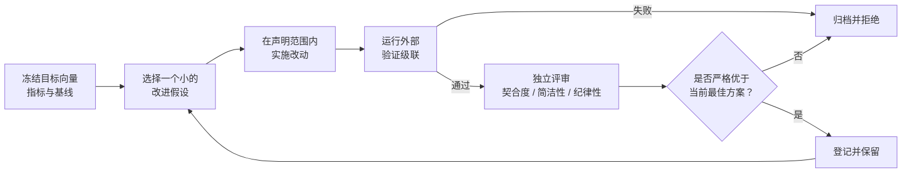

<p align="center"></p>

# ConeCode

**AI 自己思考可以做什么，用户来选择下一步。**

简体中文 · [English](README.md)

ConeCode 是基于 Electron、React 和 TypeScript 的桌面 AI 编程工作台。它从写提示词之前的问题开始：**“我接下来应该做什么？”**

打开一个项目，ConeCode 会读取文件、Git 改动、TODO、可用脚本和测试线索。点击“寻找任务”后，你选择的 AI 模型会根据项目现状提出具体的任务卡片。你挑选任务、调整方向，再让 AI 按设定的审批方式执行。

## 功能一览

- **四种 Agent 模式。** 标准模式处理一次性任务；目标模式负责长期可验证交付；编排模式拆分并派发子代理；RSI 负责有度量的自我改进。
- **先读项目再开口。** 文件、Git 改动、TODO、脚本和测试线索汇集为具体任务卡片，对话不必从空白输入框开始。
- **受限执行。** 每个文件编辑、每条命令都是显式可审批的动作卡片；macOS Seatbelt 沙箱把命令写入限制在工作区内。
- **模型管理。** 多服务商接入、收藏与最近使用、每百万 token 价格展示、单模型上下文与输出上限覆写、思考强度滑杆。
- **图像生成。** 对话中直接生成，或进入专用图像工坊；完全复用已配置的服务商凭据，无需二次填写。
- **可扩展。** 插件库、自定义 Skills、MCP 服务，以及扫码配对的手机远程访问和可选隧道。

## RSI：以可验证的方式持续改进软件

ConeCode 的 **RSI（递归自我改进）模式**不只是“让 AI 再试一次”。它面向持续、可衡量的改进任务：让测试更可靠、清除类型错误、改善完成质量、缩短可测的耗时，或把一个产品能力真正打磨到可用。

它不是无限制的自我修改。Agent 只能在当前工作区提出和实施小步候选改动；成功标准、验证命令和安全边界都固定在 Agent 自己的判断之外。



### 这个循环为什么可控

- **外部裁判，不靠自我打分。** 首轮前会在 `.conecode/rsi/GOAL_VECTOR.md` 固化目标、2–5 个指标、精确命令、基线和非目标；“看起来更好”不是成功证据。
- **硬验证门槛。** 类型检查、局部测试、完整测试和冻结指标按成本从低到高执行。任何必要条件失败即为硬失败，评审不能把红灯变绿灯。
- **每轮只改一个模块。** 候选改动只能覆盖 `loop`、`tools`、`observation`、`context`、`completion` 或 `product` 中的一项，便于归因、审查和回滚。
- **改进要支付复杂度成本。** 外部指标的提升占主导；契合度、简洁性和纪律性评审只在已通过硬验证的候选中排序，过大的改动会被扣分。
- **保留谱系而非只记胜者。** 通过验证但暂未胜出的候选也会保留其指标、证据和父节点；后续可以重访优秀但探索不足的分支，而非盲目沿一条路径爬坡。
- **发现快、登记慢。** 只有跨过证据门槛的经验、技能或工作流调整才可进入持久记录，避免一次偶然成功污染后续行为。
- **会停下来。** 到达平台期、连续硬失败、下一步不安全或越界时停止，不会为了消耗预算制造无意义改动。

RSI 不得为了跑分削弱审批、沙箱、认证、TLS、权限或测试；不得修改工作区外内容、暗中改变指标、强制推送、部署、发布或扩张自身权限。它是受约束、可审计的软件改进回路，而非“开放式无限进化”。

### 如何使用

1. 在 Agent 模式菜单选择 **RSI**，或输入 `/mode rsi`。
2. 提出可衡量的结果，例如“在不弱化测试的前提下清零类型错误”。
3. 首轮前确认章程、指标、验证命令和非目标。
4. 在 `.conecode/rsi/` 查看目标向量、迭代记录、谱系、反思、发现树和 `EVOLUTION_LOG.md`。

一次性任务适合 Standard 模式；长期、可衡量的交付适合 Goal 模式；可拆分的独立分析适合 Orchestrate 模式。只有“持续、可测的改进”本身就是任务时，才应使用 RSI。

### Agent 模式

| 模式 | 行为 | 适用场景 |
|---|---|---|
| **标准 Standard** | 默认编码循环，一次请求端到端完成 | 一次性任务与快速提问 |
| **目标 Goal** | 追踪声明目标，直到外部完成检查通过 | 长期、可验证的交付 |
| **编排 Orchestrate** | 指挥器分解任务并派发子代理，并行调研、汇总整合 | 可独立拆分再合并的研究流 |
| **RSI** | 上文的可度量改进回路 | 迭代改进本身就是任务 |

## 工作台

### 对话与命令

- **斜杠命令。** 在输入框键入 `/` 唤出自动补全面板：

  | 命令 | 动作 |
  |---|---|
  | `/help`、`/clear`、`/compact` | 帮助、重置会话、上下文压缩 |
  | `/plan`、`/review`、`/agents` | 计划模式开关、打开改动审查、查看活跃子代理 |
  | `/goal`、`/mode`、`/model`、`/memory` | 设定目标、切换 Agent 模式、打开模型选择、打开记忆 |
  | `/worktree`、`/add-dir` | 创建 Git 工作树、附加额外目录 |
  | `/init` | 为当前项目生成 `AGENTS.md` 项目简报 |
  | `/diff`、`/commit` | 总结未提交改动；全量暂存并生成规范提交信息 |
  | `/image`、`/imagine` | 用已输入文字打开图像工坊 |

  项目自定义命令放在 `<工作区>/.conecode/commands/*.md`：文件名即命令，正文即提示词模板，`$ARGUMENTS` 会被替换为命令后的输入。
- **原位编辑消息。** 编辑历史用户消息并从该处重新生成；取消则保留原对话。
- **检查点与回滚。** 对话可回滚到检查点，可撤销的文件改动随之恢复；已执行的命令和电脑操作只报告、不假装撤销。
- **交接。** 把完整对话记录（可选包含工具调用与返回）连同接手提示词导出为 `.md` 文件，拖入另一个 AI 应用即可接着干。
- **操作悬浮预览。** 在“电脑操控”面板点击“悬浮预览”，把 AI 最近获取的操作画面置顶显示在其他应用上方。预览只有画面，没有按钮、标题栏或外层卡片，拖动画面即可移动；回到主面板可关闭预览。显示预览不会自动开启电脑操控或额外抓屏，停止操控后会清空画面。更新主进程后需要重启应用。

### 任务流

- **项目感知建议。** “寻找任务”读取本地项目事实——文件、Git 改动、TODO、脚本与测试信号——提出具体下一步，由你挑选和调整。
- **从创意到项目。** 浏览项目创意、选定方向，走引导流程创建项目、运行验证并尝试修复问题。
- **执行由人决定。** 寻找工作、启动任务、执行命令、调整审批级别都是显式动作；仅打开文件夹不会授权 AI 自动执行建议。

### 模型

- **服务商。** OpenAI、Anthropic、Gemini、DeepSeek、OpenRouter 与自定义 OpenAI 兼容端点，全部使用你自己的凭据；内置 **ConeCode Free** 官方端点无需 API Key，按周计量用量。
- **选择器。** 官方免费、收藏、最近使用分组；能力图标（视觉、图像生成、音频、函数调用）；每百万 token 价格；单模型上下文窗口与最大输出覆写，支持“从 API 读取”自动刷新。
- **推理强度。** 选中支持扩展推理的模型时出现思考滑杆，可按模型单独开关。
- **上下文计量。** 显示当前对话占据所选模型上下文的比例；`/compact` 可压缩。

### 图像生成

- **两个入口。** 在对话中提出需求，Agent 会在对话与计划模式下调用原生 `generate_image` 工具；或键入 `/image` 打开图像工坊。
- **凭据零重填。** 自动匹配、官方免费或指定已配置的服务商；自定义端点支持 OpenAI 兼容的图像 API。
- **工坊控制。** 五种比例（1:1、16:9、9:16、4:3、3:4）；DALL·E 3 类模型的画质与色彩风格；其余模型可用负向提示词；十种艺术预设（真实摄影、二次元动漫、赛博朋克、3D 萌系、东方水墨、古典油画、奇幻魔法、极简美学、复古像素、硬核科幻）在本地扩充提示词。
- **画廊。** 本地保存最近 40 张；对话中的图片支持复制、保存、全屏查看，并可直接用原图提示词回到工坊再创作。
- **与其他功能同样受控。** 在插件库关闭「AI 绘图」后，模型工具表中即移除 `generate_image`。

### 插件、技能与记忆

- **插件库。** 支持搜索、启用/停用，并通过 GitHub 拉取市场插件或自建插件：

  | 插件 | 功能 |
  |---|---|
  | GitHub 同步 | 一个 Token 把当前项目一键提交并推送到 GitHub 仓库 |
  | 性能巡检 | 检查本软件的性能缺陷，只出报告、不动手 |
  | 安全审查 | 按规则审查代码漏洞，支持整仓或仅变更文件 |
  | TODO 扫描 | 全仓扫 TODO/FIXME，按陈旧程度排序 |
  | 提交信息 | 读 diff 生成规范提交信息，只写不提交 |
  | 仓库导览 | 新人地图：启动链、模块表、先读哪三个文件 |
  | AI 绘图 | 对话中生成图片，含画廊与专业工坊 |

- **插件市场（DSH 兼容）。** 侧边栏的拼图按钮打开。统一发现、安装和验证真实的 DeepSeek Harness 社区插件与本项目原生插件：固定版本的 npm / Git / 本地来源，基于 Cordis 的宿主运行时（工具、命令、Skills），逐插件配置与日志，启用/禁用、更新/回滚与卸载。市场把「作者声明的 DSH 范围」与「ConeCode 实测结果」分开展示，包含部分兼容和不兼容结论；DSH Web 客户端部分会被识别但不会挂载。固定 DSH 基线、兼容矩阵与开发说明见 [`docs/dsh-market/`](docs/dsh-market/README.md)。
- **技能。** 通过专用运行视图安装和执行技能；技能编辑器保持自定义技能可改；审批模式与命令沙箱对技能实际执行的操作依然生效。
- **记忆。** 设置内有独立记忆面板，`/memory` 可直接打开；长期任务同时保留目标、TODO 清单与上下文压缩状态，跨会话延续。

### 后台运行、通知与远程访问

- **通知。** 从不 / 仅后台 / 始终三档；需要审批时另有开关；任务运行期间可防止系统休眠。
- **费用护栏。** 费用锁可为无人值守的一轮设定预算上限（默认 0.5 美元/轮）。
- **手机访问。** 侧栏弹出扫码配对：每次安装独立生成 TLS 证书；隧道公开访问必须设置密码；cloudflared 二进制可选、不随仓库分发。

## 安全模型

审批与命令沙箱现在合并在模型栏旁的「安全策略」圆岛里——从设置整体搬出，无需进设置即可快速切换。

| 审批模式 | 行为 |
|---|---|
| **逐项确认**（默认） | 每次文件编辑与命令执行前均征求确认，安全级别最高 |
| **自动编辑** | 文件编辑自动进行，命令执行前仍征求确认 |
| **全自动执行** | 编辑与命令直接执行；整岛渲染为红色风险状态以示提醒 |

- **沙箱。** 基于 macOS Seatbelt：命令可读取本机，但只能写入工作区与临时目录，网络访问单独开关（安装依赖时需要）；每次运行使用隔离的临时目录与独立策略文件。停用或在其他平台上，命令以当前用户完整权限运行。
- **无人值守接管。** RSI 与 Autopilot 运行期间审批临时切换为全自动，结束后自动恢复；接管期间圆岛显示琥珀色提示，而插件的独立开关不受影响。
- **对话内审批。** 命令审批与文件批量审查直接出现在对话内部，只作用于当前对话。

## 从源码运行

推荐 **Node.js 24**，最低要求 22.12，并准备 npm 和 Git。目前主要在 macOS 开发和验证；仓库配置了 Windows 打包，但部分能力存在平台差异。

```bash
npm ci
npm run dev
```

`npm run dev` 会同时启动 Vite 和 Electron。运行生产构建：

```bash
npm run build
npm start
```

仓库不包含 API 密钥、签名证书、应用数据或预构建安装包。请在软件内配置自己的服务商。

## 检查命令

```bash
npm run typecheck
npm test
npm run build
npm audit
```

部分测试需要启动本机回环服务器。macOS 沙箱集成测试在本机存在 `sandbox-exec` 时以真实沙箱运行真实进程，其余平台通过条件跳过自动略过；并行测试套件复用隔离的测试工作区。

## 打包与可选的远程隧道

```bash
npm run dist        # macOS 安装包
npm run dist:win    # Windows x64 安装包
npm run dist:linux  # Linux AppImage (x64)
npm run dist:all    # 一次构建 macOS arm64、Windows x64 与 Linux x64
```

打包需要 Electron Builder 对应平台的工具。签名和公证需要自己的凭据，仓库不会携带签名材料。

Cloudflared 是可选的运行时工具，**二进制文件不提交到仓库**。需要捆绑隧道功能时，现有打包配置会寻找：

- macOS Apple Silicon：`resources/bin/cloudflared-darwin-arm64`
- Windows x64：`resources/bin/cloudflared-win-x64.exe`
- Linux x64：`resources/bin/cloudflared-linux-x64`

请从 [Cloudflare 官方发布页](https://github.com/cloudflare/cloudflared/releases) 获取对应文件。不捆绑隧道时，可移除相应的 `extraResources` 配置。应用也支持使用单独安装的隧道工具。

## 隐私与执行边界

- 对话和设置保存在 Electron 本地应用数据目录。**服务商凭据目前保存在本地 JSON 中，尚未使用系统凭据保险库。** 请保护这个目录，不要将其分享或上传。
- 调用模型时可能发送选定的项目上下文；可选的学习记忆功能也可能向所配置的服务商发起额外请求。软件并非完全离线，数据保留和计费遵循对应服务商政策。
- 默认模式会审批编辑和命令。全自动模式、自定义 Skills、MCP 服务、电脑控制和远程访问具有较大的本机操作权限，请仅在信任相关任务和工具时启用。
- 命令写入沙箱基于 macOS Seatbelt。不要假定 Windows 等平台具有同等系统隔离，也不要假定所有功能都受该沙箱约束。
- 回退编辑会删除后续对话，**不会撤销已经发生的文件修改或外部操作**。文件及检查点撤销是单独的功能；命令和外部操作可能无法回滚。
- 远程 TLS 密钥在每次安装中独立生成并保存在本机。固定信任旧共享证书的手机客户端需要更新或重新配对当前安装的证书；浏览器不会自动信任自签名证书。不需要远程访问时请保持关闭，并将配对链接视为凭据保护。

## 代码结构

```text
electron/             桌面主进程、IPC、预览、远程及电脑控制
src/components/       对话和工作台界面
  chat/               对话界面、审批卡片、图像工坊弹窗
  model/              模型选择、思考/模式切换、安全策略圆岛
  computer/ rsi/ review/ worktree/ preview/ terminal/ editor/ memory/ skills/ plugins/
  provider/           设置、服务商与插件管理
  remote/             手机访问弹层（二维码、密码、隧道）
src/stores/           Agent 循环、模式、目标、模型、设置及测试
src/core/
  agents/             RSI 奖励、验证级联、谱系、回放与提示词协议
  agenda/             项目分析及任务、创意生成
  providers/          服务商适配器（OpenAI、Anthropic、Gemini、免费中转等）
  tools/              Agent 工具定义与工具集组装
  exec/               macOS Seatbelt 沙箱与命令执行
  image/              图像工坊请求构建与艺术预设
  browser/            内置浏览器策略
  remote/             手机桥接、审批范围、二维码
  commands.ts         斜杠命令注册表
src/core/storage/     本地持久化
resources/bin/        可选捆绑的 cloudflared 二进制（不提交仓库）
preview/              独立 UI 开发示例
docs/compose/spec/    RSI 设计笔记与产品规格
```

## 参与改进

请描述问题和预期行为，保持改动聚焦，并运行相关检查。不要在 Issue 或 PR 中包含密钥、配对链接、私人日志或个人项目数据。发现安全问题时，不要公开提交利用细节或敏感信息；如果仓库提供 GitHub 私密漏洞报告入口，请优先使用。

**许可证：** [MIT](LICENSE) — 可自由使用、修改与再分发，需保留版权声明。
