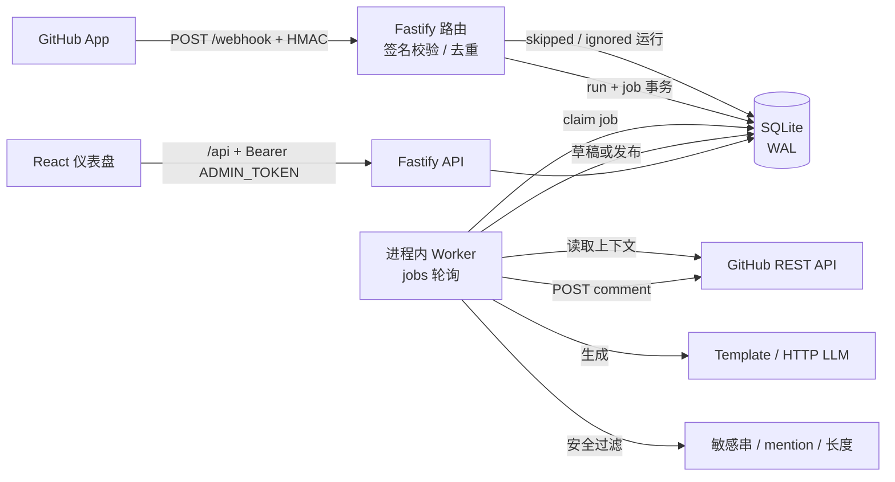

# GitHub 回复助手（github-reply-bot）

自托管的 **GitHub App + Web 服务 + 管理仪表盘**：自动读取 Issue / PR 内容，按仓库规则生成回复，默认进入**人工审核**，管理员批准后才发布到 GitHub。适合开源维护者、小团队与需要处理重复 Issue/PR 的开发者。

- **默认安全姿态**：全局自动化关闭、仓库默认关闭、所有事件开关关闭、dry-run 开启、草稿审核开启。管理员必须显式逐项开启后服务才会动作。
- **单租户、单实例**：SQLite 单文件持久化，进程内持久化队列，无 Redis、无云依赖。
- **默认离线**：回复由内置模板生成；LLM 是可选适配器，默认禁用，需自行提供兼容 OpenAI 的 HTTP 端点。

---

## 目录

- [项目定位与边界](#项目定位与边界)
- [与上层项目目录的关系](#与上层项目目录的关系)
- [架构](#架构)
- [前置条件](#前置条件)
- [本地启动（5 分钟）](#本地启动5-分钟)
- [创建并配置 GitHub App](#创建并配置-github-app)
- [环境变量](#环境变量)
- [常用命令](#常用命令)
- [Docker 部署](#docker-部署)
- [首次使用流程](#首次使用流程)
- [功能开关](#功能开关)
- [触发与决策顺序](#触发与决策顺序)
- [安全过滤（硬编码，不可关闭）](#安全过滤硬编码不可关闭)
- [状态机与失败处理](#状态机与失败处理)
- [数据、隐私与保留](#数据隐私与保留)
- [HTTP API](#http-api)
- [测试与验收](#测试与验收)
- [故障排查](#故障排查)
- [已知限制与未实现项](#已知限制与未实现项)
- [安全注意事项](#安全注意事项)
- [目录结构](#目录结构)
- [当前状态](#当前状态)

---

## 项目定位与边界

**会做**

- 接收 GitHub App webhook，校验 HMAC 签名；按 delivery id 与内容哈希去重。
- 读取 Issue/PR 标题、正文、作者、标签、最近 N 条评论、PR 变更文件列表（仅文件名/状态/增删行数）。
- 按全局 → 仓库 → 事件 → 触发者 → 限流 → 免打扰 → dry-run → 审核策略生成 `post` / `draft` / `skip` 决策。
- 用内置模板（中英文启发式）或可选 LLM 生成回复，经过安全过滤后存为草稿或发布评论。
- 仪表盘：登录、概览、仓库列表与逐仓库设置、运行列表与筛选、运行详情（编辑/批准/拒绝/重试）、全局设置、审计与 webhook 健康。
- 失败重试（最多 3 次，指数退避）、错误可见、状态机保护、保留期自动清理。

**明确不做**

- 不修改代码、不自动合并/关闭 Issue/PR、不自动批准 review、不封禁用户、不做内容审核处罚。
- 不做浏览器扩展、Slack/邮件集成、多租户 SaaS、计费、分析报表、模型训练。
- 不自动抓取私有数据到第三方；只有管理员显式启用 `http_llm` 并配置端点时才会把上下文发送到该端点。
- 不内置 TLS、反向代理、GitHub OAuth 或多实例高可用。

---

## 与上层项目目录的关系

本服务位于 ConeCode 仓库目录下的**独立子项目** `github-reply-bot/`，拥有自己的 `package.json`、`node_modules`、构建产物与测试，**不修改 ConeCode 的任何源文件、构建配置或脚本**，也不参与 ConeCode 的 Electron 打包。删除该子目录即可完全回滚。

---

## 与 ConeCode GitHub 插件的集成

ConeCode 设置 → 插件 → **GitHub 同步** 内新增「回复助手」页签（源码：`src/components/plugins/ReplyAssistantView.tsx`，主进程请求：`electron/githubReply.ts`）：

- 与推送页共用 owner/repo 和 GitHub Token；未保存 Token 时只能读取公开仓库，不能发布。
- 列出打开的 Issue/PR，读取正文与最近评论，用本地模板生成可编辑草稿，**确认后**才通过主进程调用 GitHub API 发布。
- 复用硬编码安全过滤：阻止疑似密钥内容、去除 `@everyone` / `@channel`、限制 mention 数量与长度。
- 主进程发起请求（避免 CORS），Token 只从本机 localStorage 读取并由 IPC 传入，不写入 git 配置。

两种使用方式并存：

| 方式 | 入口 | 能力 |
| --- | --- | --- |
| 手动回复助手 | ConeCode GitHub 插件「回复助手」页签 | 人工选择线程、生成/编辑草稿、确认发布；无 webhook、无自动运行 |
| 自动回复服务 | 本子项目（`npm start` / Docker） | webhook 自动处理、策略开关、草稿审核、自动发布、运行记录与审计 |

> 插件页签不读写本服务的 SQLite 数据库，也不替代 webhook 自动化；需要自动处理新 Issue/PR 时仍运行本服务并配置公网 webhook。

---

## 架构



| 组件 | 实现 | 职责 |
| --- | --- | --- |
| Webhook 入口 | Fastify + `node:crypto` HMAC-SHA256 | 校验 `X-Hub-Signature-256`，解析 opend/edited/labeled/comment/installation 事件 |
| 持久化 | `better-sqlite3` + `drizzle-orm` | 安装、仓库、设置、运行、任务、审计、模板；SQL 迁移在 `drizzle/` |
| 队列 | `jobs` 表 + 进程内轮询 | 持久化、可重试、单实例安全 |
| 策略引擎 | 纯函数 `src/server/policy/engine.ts` | 所有跳过原因可解释、可测试 |
| 生成器 | `TemplateGenerator`（默认）/ `HttpLlmGenerator`（可选） | LLM 失败强制回退模板并标记 `fallback_used` |
| 安全过滤 | `src/server/safety/filter.ts` | 密钥拦截、mass mention 清理、mention 上限、长度截断 |
| GitHub 客户端 | `@octokit/app` + `@octokit/rest` | App JWT、installation token、读上下文、发评论、查 collaborator 权限（缓存 5 分钟） |
| 仪表盘 | React 18 + Vite + React Router | 登录、概览、仓库、运行、设置；空/加载/错误状态齐全 |
| 部署 | 多阶段 Dockerfile + compose | 非 root 用户、持久化 volume、容器健康检查 |

---

## 前置条件

- Node.js **>= 20.11**（开发与验证使用 Node 22.23.2，npm 10.9.8）。
- 可访问 `registry.npmjs.org` 安装依赖；`better-sqlite3` 优先使用预编译二进制，失败时需要 Python 3 与 C++ 构建链。
- 一个 GitHub 账号，可创建 GitHub App 并安装到目标仓库。
- 公网 HTTPS 地址（或本地隧道）供 GitHub 投递 webhook。仪表盘自身不提供 TLS。

---

## 本地启动（5 分钟）

```bash
cd github-reply-bot
npm install
cp .env.example .env
# 编辑 .env：至少填写 ADMIN_TOKEN、GITHUB_APP_ID、GITHUB_PRIVATE_KEY、GITHUB_WEBHOOK_SECRET、GITHUB_APP_SLUG
npm run dev
```

- 后端：<http://127.0.0.1:3000>（`/health`、`/webhook`、`/api/*`）。
- 前端开发服务器：<http://127.0.0.1:5173>，`/api`、`/webhook`、`/health` 自动代理到 3000。
- 首次启动会自动执行 `drizzle/*.sql` 迁移、写入默认全局设置、种子 4 个内置模板，无需手动建库。

生产模式（单进程同时提供 API 与静态仪表盘）：

```bash
npm run build      # dist/server/index.js + dist/web
npm start          # 读取 .env，监听 3000，仪表盘与 API 同源
```

> 未配置 GitHub 凭据时服务**不会崩溃**：`/health` 返回 `githubConfigured:false` 与缺失项，仪表盘显示配置警告，`/webhook` 返回 503 并给出清晰错误；配置后重启即可。
>
> 未配置 `ADMIN_TOKEN` 时管理 API 与登录返回 503，不会以空密码放行。

---

## 创建并配置 GitHub App

1. 打开 GitHub → **Settings → Developer settings → GitHub Apps → New GitHub App**。
2. **Homepage URL** 填任意可访问地址（例如你的部署域名）。
3. **Webhook URL** 填 `https://<你的公网域名>/webhook`；**Webhook secret** 填一个随机字符串，与 `.env` 中的 `GITHUB_WEBHOOK_SECRET` 完全一致。
4. **Repository permissions**（最小权限）：
   | 权限 | 级别 | 用途 |
   | --- | --- | --- |
   | Issues | Read & write | 读取 Issue、发表评论 |
   | Pull requests | Read & write | 读取 PR 与变更文件列表、发表评论 |
   | Metadata | Read | 必需的基础元数据 |
   | Contents | Read（可选） | 本实现不读取文件内容；仅当你的合规流程要求时保留，否则可移除 |
5. **Subscribe to events** 勾选：
   - Issues
   - Issue comment
   - Pull request
   - Pull request review comment
   - Installation
   - Installation repositories

   （Ping 事件默认启用，服务会返回 202 `pong`。）
6. **Where can this GitHub App be installed?** 选择 *Only on this account*（单租户自托管）。
7. 创建后记录 **App ID**；在 App 页面 URL `/apps/<slug>` 中记录 **slug**，填入 `GITHUB_APP_SLUG`（用于识别 `@<slug>` 提及）。
8. 在 App 页面底部 **Generate a private key**，下载 `.pem`。把它填进 `.env` 的 `GITHUB_PRIVATE_KEY`：可直接粘贴多行 PEM，也可写成带 `\n` 的单行，服务启动时会还原换行。
9. 点击 **Install App**，选择要授权的仓库。安装/变更会触发 `installation` / `installation_repositories` 事件，仓库自动同步到仪表盘，**默认全部关闭**。
   - 若仓库列表为空，确认 webhook 已能到达 `/webhook`，或在 GitHub 上重新配置安装以触发同步。
10. 本地调试时用隧道把 3000 端口暴露为 HTTPS：
    ```bash
    cloudflared tunnel --url http://127.0.0.1:3000
    # 或
    ngrok http 3000
    ```
    把生成的 `https://...` 地址加 `/webhook` 填回 GitHub App。

---

## 环境变量

`.env` 会被 `npm run dev`、`npm start`、`npm run db:migrate` 自动加载（`dotenv`）。Docker 通过 compose 的 `env_file` 注入。

| 变量 | 必填 | 默认值 | 说明 |
| --- | --- | --- | --- |
| `NODE_ENV` | 否 | `development` | `development` / `test` / `production` |
| `PORT` | 否 | `3000` | HTTP 监听端口 |
| `HOST` | 否 | `0.0.0.0` | 监听地址；仅本机可设 `127.0.0.1` |
| `LOG_LEVEL` | 否 | `info` | pino 级别：`fatal`…`trace`、`silent` |
| `DATABASE_URL` | 否 | `file:./data/reply-bot.db` | SQLite 路径，`file:` 前缀可选；也支持 `:memory:` |
| `ADMIN_TOKEN` | **是** | — | 仪表盘与 `/api/*` 的 Bearer 令牌；建议 `openssl rand -hex 32` |
| `GITHUB_APP_ID` | **是** | — | GitHub App ID（数字） |
| `GITHUB_PRIVATE_KEY` | **是** | — | App 私钥 PEM，支持字面 `\n` |
| `GITHUB_WEBHOOK_SECRET` | **是** | — | webhook HMAC 密钥；与 GitHub App 设置一致 |
| `GITHUB_APP_SLUG` | 建议 | — | App slug，用于识别 `@<slug>`；缺失时提及触发会被跳过并记录原因 |
| `LLM_ENDPOINT` | 否 | — | 兼容 OpenAI 的 `POST` 端点（接受 `{model, messages}`） |
| `LLM_API_KEY` | 否 | — | 发送为 `Authorization: Bearer <key>` |
| `LLM_MODEL` | 否 | `gpt-4o-mini` | 传给端点的 `model` 字段 |
| `LLM_TIMEOUT_MS` | 否 | `15000` | LLM 请求超时（1000–60000） |
| `WORKER_INTERVAL_MS` | 否 | `1000` | 队列轮询间隔（50–60000） |
| `RETENTION_SWEEP_INTERVAL_MS` | 否 | `3600000` | 保留期清理间隔，最小 60000 |
| `PUBLIC_DIR` | 否 | `dist/web` | 仪表盘静态文件目录 |
| `MIGRATIONS_DIR` | 否 | `drizzle` | SQL 迁移目录 |

缺失情况的明确行为：缺 GitHub App 凭据 → 启动成功但读取/发布报 `github_app_not_configured`；缺 webhook secret → `/webhook` 503；缺 `ADMIN_TOKEN` → 管理 API 503。

---

## 常用命令

```bash
npm install          # 安装依赖
npm run dev          # 后端 tsx watch + Vite 前端（5173）
npm run build        # 构建服务端（tsup → dist/server）与前端（Vite → dist/web）
npm start            # 运行构建产物
npm run typecheck    # tsc --noEmit（含测试）
npm test             # vitest run（全部单元/集成/组件测试）
npm run lint         # eslint（flat config）
npm run db:migrate   # 手动执行未应用的迁移（启动时也会自动执行）
npm run db:seed      # 补充内置模板（幂等）
```

---

## Docker 部署

```bash
cd github-reply-bot
cp .env.example .env    # 填写 ADMIN_TOKEN 与 GitHub App 凭据
docker compose up -d --build
docker compose logs -f
```

- 镜像：多阶段构建，运行阶段使用 `node:22-bookworm-slim` + 非 root 用户（UID 1001）+ `dumb-init`。
- 数据：SQLite 位于容器内 `/app/data/reply-bot.db`，通过命名卷 `reply-bot-data` 持久化。
- 端口：`3000:3000`；容器健康检查每 30 秒请求 `/health`。
- 反向代理示例（Caddy/Nginx）终结 TLS 后转发到 `127.0.0.1:3000`；仅暴露需要的路径。
- 容器内已安装 CA 证书，`https` 调用（GitHub API / LLM 端点）可直接工作。
- 如宿主机卷权限异常，执行 `docker compose down && docker volume rm github-reply-bot_reply-bot-data` 后重建（会清空数据）。

---

## 首次使用流程

### 旅程 A：草稿审核（默认路径）

1. 完成 GitHub App 安装并启动服务，打开仪表盘用 `ADMIN_TOKEN` 登录。
2. 「仓库」页启用目标仓库（需二次确认）。
3. 进入仓库设置：打开 `issues.opened`，保持「需要人工审核」。
4. 在 GitHub 新建测试 Issue。webhook 到达后，运行记录显示 `drafted`。
5. 运行详情中查看上下文摘要与生成内容，编辑后点击「批准并发布」并确认。
6. 服务调用 GitHub API 发布评论，状态变为 `posted`，保存 `posted_comment_id`。
7. 若点「拒绝」，状态变为 `rejected`，不会发布。

### 旅程 B：自动发布

1. 全局开启自动化并**关闭 dry-run**。
2. 仓库设置：启用仓库、打开 `issues.opened`、开启「自动发布」（此时人工审核自动关闭）、设置触发标签 `bot-reply` 与每小时上限 10。
3. 新 Issue 携带该标签且触发者拥有 **maintain/admin** 权限时，策略返回 `post`，安全过滤通过后自动发布评论。
4. 审计日志记录触发者、事件、模板与发布结果。

### 旅程 C：失败与恢复

1. GitHub API 返回 403/429/5xx 或网络错误：任务进入 `retrying`，按 30s/60s/120s 退避重试，最多 3 次；超过后 `failed`，仪表盘显示错误代码与摘要，可点「重试」。
2. 生成器异常：模板始终可用，因此 LLM 失败会回退模板并标记 `fallback_used`；若模板也会抛错（注入的自定义生成器），运行 `failed`，**绝不发布半成品**。
3. 重复 webhook delivery 或相同内容哈希：只创建一条运行、最多一条评论。

---

## 功能开关

### 全局（`global_settings`）

| 开关 | 默认 | 说明 |
| --- | --- | --- |
| `automationEnabled` | `false` | 关闭时 webhook 仅记录 `skipped`（`automation_disabled`），不读取内容、不生成、不发布 |
| `dryRun` | `true` | 生成并记录草稿，但任何路径都不调用发布 API；批准接口返回 409 |
| `generatorProvider` | `template` | `template` / `http_llm`；选 `http_llm` 但未配置 `LLM_ENDPOINT` 时保存返回 400，不静默降级 |
| `retentionDays` | `30` | 1–365；后台每小时清理过期运行/草稿/审计 |
| `defaultReplyLanguage` | `auto` | `auto`（CJK 启发式）/ `zh-CN` / `en` |

### 仓库（`repo_settings`）

| 字段 | 默认 | 取值/说明 |
| --- | --- | --- |
| `repoEnabled` | `false` | 仓库总开关 |
| `onIssueOpened` | `false` | 新 Issue |
| `onIssueLabeled` | `false` | Issue 打标签（需要触发标签） |
| `onPrOpened` | `false` | 新 PR |
| `onPrLabeled` | `false` | PR 打标签（需要触发标签） |
| `onMention` | `false` | 评论中 `@<slug>` |
| `autoPostEnabled` | `false` | 自动发布；为 `true` 时 `requireApproval` 必须为 `false`（服务端强校验） |
| `requireApproval` | `true` | 草稿审核 |
| `triggerLabels` | `[]` | 非空时，Issue/PR 必须带其中之一；为空时 `labeled` 事件直接跳过 |
| `mentionTriggerEnabled` | `false` | 与 `onMention` 同时开启才识别提及 |
| `allowedTriggerRoles` | `maintainer` | `maintainer`（仅 maintain/admin 可自动发布）/ `anyone`（任何人都能触发，但**只能生成草稿**） |
| `rateLimitPerHour` | `10` | 1–100；按仓库统计最近 1 小时内已触发（drafted/approved/posting/posted/retrying）运行 |
| `quietHoursEnabled` | `false` | 免打扰；窗口内到达的触发直接 `skipped`（`quiet_hours`） |
| `quietHoursStart` / `End` | `22:00` / `08:00` | `HH:mm`，含开始不含结束，支持跨午夜；`start === end` 视为关闭 |
| `quietHoursTimezone` | `UTC` | IANA 时区；非法值保存时 400 |
| `maxReplyChars` | `2000` | 200–8000，超出截断并加提示 |
| `maxContextComments` | `10` | 0–50 |
| `maxChangedFiles` | `20` | 0–100，只取文件名/状态/增删行数 |
| `templateId` | `null` | 绑定内置或自定义模板；`null` 时按语言与类型自动选择 |
| `storeEventPayload` | `false` | 是否把完整 webhook payload 存进运行记录（最多 64 KB，仅排障） |

> 说明：`trigger_labels` 只做「是否触发」过滤；按标签选择不同模板属于 P1，未实现。

---

## 触发与决策顺序

1. 校验签名（失败 401，仅写审计，不创建可执行任务）。
2. 校验 `X-GitHub-Delivery`；记录 `webhook.received` 审计。
3. `ping` → 202 `pong`；`installation*` → 同步安装与仓库；未知事件 → 202 + 审计。
4. 解析 payload（zod）：`issues` / `issue_comment` / `pull_request` / `pull_request_review_comment`。
5. **无 GitHub 调用的粗筛**：全局自动化关闭 → `skipped`；仓库关闭 → `skipped`；无触发动作（edited、普通评论、review comment）→ `ignored`；事件开关关闭 → `skipped`；bot 触发者 → `skipped`。
6. 通过粗筛：事务创建 `received` 运行 + `process` 任务。
7. Worker：再次校验开关（防竞态）→ 查触发者权限（失败降级为草稿）→ 策略矩阵（标签、限流、免打扰、dry-run、角色、审核）。
8. 读取上下文 → 生成 → 安全过滤 → 草稿或发布。
9. 发布前再检查 `automation_enabled`、`dry_run`、仓库开关、事件开关，并再次检测重复回复。

## 安全过滤（硬编码，不可关闭）

- 永不回复 bot 账号、永不回复自身（`<slug>[bot]`）。
- 回复中出现密钥样式（`ghp_`、`github_pat_`、`sk-`、`AKIA…`、Slack token、JWT、PEM 私钥、`password=…` 等）→ `blocked_sensitive`，**不保存原文**、不发布。
- 移除 `@everyone` / `@channel` / `@here`，最多保留 3 个 mention。
- 按 `max_reply_chars` 截断，空内容拒绝发布。
- 同一 delivery / 同一内容哈希只处理一次，已发布的同一触发不重复回复。
- webhook 签名失败 → 401，不入库为可执行任务。

---

## 状态机与失败处理

状态：`received` → `drafted` → `approved` → `posting` → `posted`；异常分支 `retrying` → `failed`；跳过分支 `ignored` / `skipped`；安全分支 `blocked_sensitive`；人工分支 `rejected`。

| 场景 | 行为 |
| --- | --- |
| GitHub 403 / 429 / 5xx / 网络错误 | `retrying`，退避 30s → 60s → 120s，最多 3 次；仍失败则 `failed` |
| GitHub 4xx（非 403/429） | 立即 `failed`，不重试 |
| 权限查询失败 | 记录警告，按 `unknown` 处理 → 只能生成草稿 |
| LLM 超时/异常 | 回退模板，`fallback_used=true`，草稿可见 |
| 生成器抛错 | `failed`（`generation_failed`），不发布 |
| 运行/发布期间开关被关闭 | 发布前复查 → `skipped`，原因写进 `reason` |
| 重复 webhook | 202 `duplicate`，不创建新运行、不重复评论 |
| 数据库写入 run 与 job | 同一事务，避免半完成状态 |

批准/拒绝/重试的状态保护：非法转换返回 **409**；批准时若回复含敏感内容返回 **422** 且运行标记 `blocked_sensitive`。

---

## 数据、隐私与保留

- SQLite 单文件（WAL 模式），位于 `DATABASE_URL` 指定路径；表：`installations`、`repositories`、`repo_settings`、`global_settings`、`reply_templates`、`runs`、`audit_logs`、`jobs`。
- 上下文摘要在运行记录中**只保留摘要**：
  - 标题、作者、标签、正文前 500 字符、最近评论前 200 字符、变更文件元数据（文件名/状态/增删行数），不保存 diff。
  - 完整 webhook payload 仅在 `store_event_payload=true` 时保存，单条最多 64 KB。
- 日志对 `authorization`、`cookie`、`x-hub-signature-256`、`set-cookie` 做脱敏；不打印私钥或 token。
- 数据驻留在你的机器/SQLite 文件中；不向第三方发送任何内容，**除非**管理员启用 `http_llm` 并配置端点。此时仪表盘会显示数据外发警告，请自行评估合规。
- 保留策略：每小时清理早于 `retentionDays` 且处于结束状态（posted/rejected/failed/skipped/ignored/blocked_sensitive/drafted/approved）的运行与过期审计；`received`/`retrying`/`posting` 不会被清理。
- 备份：停止服务后复制 SQLite 文件（及 `-wal`/`-shm`），或使用 `sqlite3 .backup`。

---

## HTTP API

除 `GET /health`、`POST /webhook`、`POST /api/auth/login` 外，所有 `/api/*` 需要 `Authorization: Bearer <ADMIN_TOKEN>`（常量时间比较）。登录失败按 IP 限速（10 次/分钟，进程内）。

| 方法与路径 | 说明 |
| --- | --- |
| `GET /health` | 版本、配置完整度、缺失项 |
| `POST /webhook` | GitHub webhook（HMAC 校验） |
| `POST /api/auth/login` | `{token}` → `{ok:true}`；错误返回 401/503 |
| `GET /api/overview` | 全局状态、今日统计、待审草稿、webhook 健康 |
| `GET /api/settings` / `PUT /api/settings` | 全局设置（部分更新） |
| `GET /api/repos` | 仓库列表（含设置） |
| `GET /api/repos/:id` / `PATCH /api/repos/:id` | 详情 / 启用停用 |
| `PUT /api/repos/:id/settings` | 仓库策略（范围、互斥、时区、模板校验） |
| `GET /api/runs?status=&page=&pageSize=` | 运行列表（分页） |
| `GET /api/runs/:id` | 运行 + 任务 + 审计 |
| `POST /api/runs/:id/approve` | `{reply?}` → approved 并入队发布；dry-run 时 409 |
| `POST /api/runs/:id/reject` | `{reason?}` → rejected |
| `POST /api/runs/:id/retry` | failed/retrying → received 并重新入队 |
| `GET /api/templates` | 模板列表（含 4 个内置） |
| `POST /api/templates` / `PUT /api/templates/:id` / `DELETE /api/templates/:id` | 自定义模板 CRUD；内置模板不可删除（409） |
| `GET /api/audit?limit=` | 最近审计（最多 200 条） |

---

## 测试与验收

```bash
npm run typecheck
npm test
npm run lint
npm run build
```

测试覆盖（11 个测试文件，详见 `tests/`）：

| 验收要求 | 对应测试 |
| --- | --- |
| 无有效签名 → 401 且无可执行 run | `webhook.flow.test.ts` |
| 全局关闭 → 202 / `skipped`，无 GitHub 调用 | `webhook.flow.test.ts` |
| 仓库或事件关闭 → `skipped` 且 reason 说明 | `webhook.flow.test.ts` |
| 草稿 → 批准 → 恰好一条评论 + comment id | `webhook.flow.test.ts` |
| 自动发布（标签/角色/速率/免打扰条件） | `webhook.flow.test.ts`、`policy.test.ts`、`worker.failures.test.ts` |
| 重复 delivery / 内容哈希只处理一次 | `webhook.flow.test.ts` |
| dry-run 任何路径都不发布 | `webhook.flow.test.ts`、`api.test.ts`、`worker.failures.test.ts` |
| 生成器异常不发布、错误可见 | `worker.failures.test.ts` |
| 敏感串 → `blocked_sensitive` 且不落原文 | `safety.test.ts`、`worker.failures.test.ts`、`api.test.ts` |
| 超限流 → skip 且不发布 | `webhook.flow.test.ts` |
| PR 文件数受 `max_changed_files` 限制、摘要无 diff | `webhook.flow.test.ts` |
| 仪表盘未认证 401、空状态/错误态 | `api.test.ts`、`frontend.test.tsx` |
| 策略矩阵、签名、安全过滤、模板、设置校验 | `policy.test.ts`、`signature.test.ts`、`safety.test.ts`、`template.test.ts`、`settings.test.ts` |
| 配置为空/非法值时的启动行为 | `config.test.ts` |
| maintain 角色识别（`role_name` 映射）、缺凭据时明确报错 | `githubClient.test.ts` |
| 非法状态转换 → 409 | `api.test.ts`、`worker.failures.test.ts` |
| 登录 / 仓库设置保存 / 运行批准组件流程 | `frontend.test.tsx` |

实际执行结果记录在文末「当前状态」。

---

## 故障排查

| 现象 | 排查 |
| --- | --- |
| `/webhook` 一直 401 | `GITHUB_WEBHOOK_SECRET` 与 GitHub App 不一致；反向代理改写了 JSON；确认字段是 `X-Hub-Signature-256`（sha256）；服务用原始字节校验 |
| `/webhook` 返回 503 | 未配置 `GITHUB_WEBHOOK_SECRET`；补齐后重启 |
| 登录/接口 503 `admin_token_not_configured` | 未设置 `ADMIN_TOKEN` |
| 仓库列表为空 | 安装事件未到达；检查 webhook 投递记录，或重新安装/配置 App 触发 `installation` 事件 |
| 收到 webhook 但运行全是 skipped | 自动化关闭、仓库未启用、事件开关未开、bot 触发者、或标签不匹配；查看运行的 `reason` |
| 草稿一直无法批准 | dry-run 开启（409）；先关闭 dry-run |
| 自动发布不生效 | 需要 maintain/admin 权限、`auto_post_enabled=true`、`require_approval=false`、非 anyone 模式、标签与限流/免打扰均通过 |
| `@提及` 不触发 | 需要 `GITHUB_APP_SLUG`、`onMention` 与 `mentionTriggerEnabled` 同时开启 |
| LLM 保存报 400 | 未配置 `LLM_ENDPOINT`；配置后重启，或改回 `template` |
| 生成器总是回退模板 | LLM 端点不可达/超时/返回格式不含 `choices[0].message.content`；查看运行详情 `fallback_used` 与日志 |
| `better-sqlite3` 安装失败 | 安装 Python 3 与构建工具，或 `npm rebuild better-sqlite3`；Node 版本需 ≥ 20 |
| Docker 卷权限错误 | 卷归属 UID 1001；`docker compose down` 后重建卷（会清空数据），或使用绑定挂载并 `chown 1001` |
| 页面刷新 404 | 应通过 `npm start`（含静态托管与 SPA fallback）访问，而不是直接打开 `dist/web/index.html` |

---

## 已知限制与未实现项

**架构限制**

- 单实例：SQLite + 进程内 worker。多实例部署需要共享 Postgres/Redis 队列（未实现）。
- 队列轮询间隔默认 1s，非实时；单实例吞吐有限。
- 权限缓存 5 分钟：刚调整权限的触发者可能有短暂延迟。
- 去重基于 delivery id + 内容哈希：完全相同的重复事件（例如同一标签重复添加且内容一致）只处理一次。
- 若发布请求在 GitHub 已写入评论后于网络层超时，重试可能产生一条重复评论（未实现按内容搜索去重）。
- 回复只作为 Issue/PR conversation 评论；PR review comment **线程回复**未实现（事件仅记录 `ignored`）。

**P1（未实现）**

- 仪表盘内模板编辑器与预览（API CRUD 已可用，UI 仅能选择模板）。
- Slash 命令 `/bot status`、`/bot draft`、`/bot off`。
- Webhook 重放。
- 按标签路由不同模板（当前 `trigger_labels` 仅控制是否触发）。

**P2（不做）**

- 多租户 SaaS、计费、分析报表、代码修复/自动合并/自动批准。

**扩展字段说明**

为满足运行可解释性与幂等，`runs` 在任务书基础上增加了 `dedupe_key`、`trigger_kind`、`labels`、`event_payload` 四列；`repo_settings.template_id` 未加外键（避免建表顺序循环），由 API 校验模板存在性。

---

## 安全注意事项

- **不要把仪表盘暴露到公网**：它只有单一 `ADMIN_TOKEN` 认证，无 OAuth、无 2FA。需要公网访问时务必加反向代理、TLS、IP 白名单或额外认证层。
- `ADMIN_TOKEN` 使用高强度随机值，定期轮换；泄漏后立即轮换并检查审计日志。
- GitHub App 私钥只放在 `.env` 或密钥管理中，文件权限 `600`，不要提交到仓库。
- 遵循最小权限：不需要 Contents 权限时移除；仅安装到目标仓库。
- 首次部署保持 dry-run 与人工审核，观察若干次草稿后再考虑自动发布；不要同时开启 `anyone` 与自动发布（服务端设计上任何用户触发都只能生成草稿）。
- 谨慎开启 `store_event_payload`：完整 payload 可能包含用户提交的敏感信息，只应短期排障使用。
- 启用 `http_llm` 会把 Issue/PR 上下文发送到第三方端点；确认端点可信并符合数据合规要求。
- 回复内容会经过硬编码安全过滤，但**不能替代人工审查**；批准前请阅读草稿。
- SQLite 文件包含运行与审计数据，注意磁盘权限与备份加密。

---

## 目录结构

```text
github-reply-bot/
├── drizzle/0000_init.sql          # SQLite 迁移（启动时自动执行）
├── src/
│   ├── shared/                    # 前后端共享类型与 zod 校验
│   ├── server/
│   │   ├── config.ts              # 环境变量解析与缺失项报告
│   │   ├── db/                    # schema / 迁移 / store / CLI
│   │   ├── github/                # Octokit 客户端与未配置时的安全桩
│   │   ├── webhook/               # 签名校验、payload 归一化、路由
│   │   ├── policy/                # 纯函数策略引擎
│   │   ├── generator/             # 内置模板 + HTTP LLM 适配器
│   │   ├── safety/                # 敏感串 / mention / 长度过滤
│   │   ├── worker/                # 上下文构建、队列执行、重试
│   │   ├── api/                   # 管理 API 与认证
│   │   ├── app.ts                 # Fastify 组装
│   │   └── index.ts               # 启动、保留期清理、优雅退出
│   └── web/                       # React 仪表盘
├── tests/                         # 单元 / 集成 / API / 组件测试
├── Dockerfile
├── docker-compose.yml
├── .env.example
└── README.md
```

---

## 当前状态

- 版本：`0.1.0`（MVP，P0 全部实现）。ConeCode GitHub 插件已内置手动「回复助手」页签（列表 / 本地草稿 / 确认发布）。
- 验证命令与结果：
  - `npm run typecheck` → 通过（0 错误）。
  - `npm test` → 92 个测试全部通过（11 个测试文件）。
  - `npm run lint` → 通过（0 警告/错误）。
  - `npm run build` → 成功（`dist/server/index.js` + `dist/web`）。
  - 构建产物冒烟：无 GitHub 凭据启动成功，`/health` 报告缺失项，`/` 返回仪表盘，未认证 `/api/overview` 401，带令牌 200，`/webhook` 503。
  - Docker：`docker build` 在本机验证时于容器内 `npm ci` 阶段因 registry 连接被重置（`ECONNRESET`）失败，属于网络环境问题；镜像未构建成功，因此**未完成容器运行验证**。Dockerfile 与 compose 仅做了静态审查，请在网络稳定时执行 `docker compose up -d --build` 复核。
- 仍需你提供：GitHub App ID、私钥、webhook secret、App slug，以及一个可从 GitHub 访问的 HTTPS webhook 地址。缺少这些不影响启动与本地验证，但无法读取/发布真实内容。
